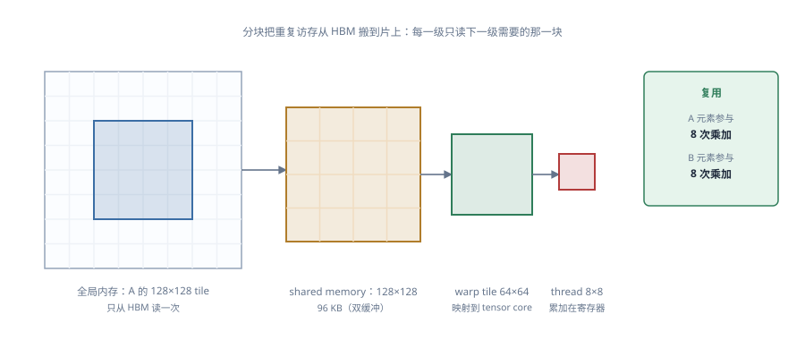

# Chapter 20. Matrix Multiplication Optimization

LLM 的绝大部分 FLOPs 花在矩阵乘法上。一个 70B 模型每生成一个 token，要读 140 GB 的权重，其中 GEMM 权重占九成以上；prefill 阶段则要把这些权重和成千上万个 token 的激活相乘。GEMM 快一倍，整个系统就快接近一倍。

但 GEMM 也是最能体现 GPU 优化全套方法的地方：tiling 解决数据复用，shared memory 解决延迟，寄存器 tiling 解决带宽，Tensor Core 解决算力，流水线解决重叠。这一章从最朴素的实现开始，一层一层加到接近硬件峰值，每一层都给出它解决的问题和它的上限。

## 20.1 GEMM Fundamentals

GEMM 计算：

$$
C_{M \times N} = A_{M \times K} \times B_{K \times N}
$$

- `M`：输出行数，通常是 batch × sequence length；
- `N`：输出列数，通常是输出特征维度；
- `K`：归约维度，通常是输入特征维度。

### 计算量与访存量

$$
\text{FLOPs} = 2MNK, \quad
\text{bytes} = 2(MK + KN + MN)
$$

系数 2 来自乘加各算一次；bytes 按 FP16 的 2 字节计，最后一项是写回 `C`。

算术强度：

$$
I = \frac{2MNK}{2(MK + KN + MN)}
$$

当 `M = N = K = n` 时，`I = n / 3`。H100 FP16 的脊点是 295 FLOP/Byte，对应 `n ≈ 885`。也就是说，方阵维度小于约 885 时，朴素 GEMM 是带宽受限的；只有大矩阵才可能跑到算力上限。

### LLM 里的 GEMM 形状

| 场景 | M | N | K | 受限类型 |
| --- | --- | --- | --- | --- |
| prefill FFN | batch×seq（数百到数千） | 2×intermediate | hidden | 通常 compute-bound |
| prefill attention | seq | seq | head_dim | 小 K，偏带宽 |
| decode FFN | batch（1–数百） | intermediate | hidden | memory-bound |
| decode attention | batch | seq | head_dim | memory-bound |

decode 的 `M` 很小，矩阵退化成 GEMV：每个权重只被使用一次，算术强度接近 1。这时 GEMM 的性能完全由 HBM 带宽决定，和 Tensor Core 的峰值无关。

## 20.2 Naive Matrix Multiplication

最直接的实现：一个线程算一个输出元素。

```cuda
__global__ void gemm_naive(const float* A, const float* B, float* C,
                           int M, int N, int K) {
  int row = blockIdx.y * blockDim.y + threadIdx.y;
  int col = blockIdx.x * blockDim.x + threadIdx.x;
  if (row >= M || col >= N) return;

  float acc = 0.0f;
  for (int k = 0; k < K; ++k) {
    acc += A[row * K + k] * B[k * N + col];
  }
  C[row * N + col] = acc;
}
```

每个输出要读 `2K` 个元素。同一行的 `A[row][k]` 被 `N` 个线程重复读，同一列的 `B[k][col]` 被 `M` 个线程重复读。没有显式复用，只能靠 L1/L2 碰运气。

结果：H100 上大约 1–2 TFLOPS，不到峰值的 1%。瓶颈不是算力，是 HBM。

## 20.3 Tiling and Blocking

Tiling 的思路：让一个 block 负责一小块输出，把这块输出需要的 `A`、`B` 数据搬到 shared memory，在 block 内复用。

假设 block tile 是 `T × T`：

- 每个 block 读 `2TK` 个元素；
- 计算 `2T²K` 个 FLOP；
- 算术强度 `T/2`。

`T = 32` 时强度 16，`T = 128` 时 64。单靠 block tile 还到不了 295 的脊点，但已经把 HBM 流量降低了一到两个数量级。

### 多级 tile

实际 GEMM 有三层 tile：

| 层级 | 典型大小 | 存储 | 作用 |
| --- | --- | --- | --- |
| Threadblock tile | 128×128×32 | shared memory | 减少 HBM 流量 |
| Warp tile | 64×64×32 | 寄存器 + shared | 减少 shared memory 流量 |
| Thread tile | 8×8 | 寄存器 | 提高 ILP，摊薄指令开销 |

每一层都把数据复用一次。到 thread tile 这一层，每个线程用 8×8 个累加器，一次 load 可以参与 64 次 FMA。

### 为什么需要 L2

单看一个 block，128×128 的 tile 强度只有 64，仍低于 295。但相邻 block 会读同一行 `A` 或同一列 `B`：

```text
block(0,0) 读 A[0:128, :] 和 B[:, 0:128]
block(0,1) 读 A[0:128, :] 和 B[:, 128:256]
```

`A` 的同一块被两个 block 读，第二次可以命中 L2。L2 带宽约 10 TB/s，是 HBM 的 3 倍，把有效强度推过脊点。

所以 GEMM 的调度顺序（block 的 swizzle）会影响 L2 命中率。CUTLASS 的 rasterization 就是干这个的。

## 20.4 Shared Memory Tiling

先写一个正确的 shared memory 版本。block 16×16，每个线程算一个输出：

```cuda
#define TILE 16

__global__ void gemm_shared(const float* A, const float* B, float* C,
                            int M, int N, int K) {
  __shared__ float As[TILE][TILE];
  __shared__ float Bs[TILE][TILE];

  int row = blockIdx.y * TILE + threadIdx.y;
  int col = blockIdx.x * TILE + threadIdx.x;
  float acc = 0.0f;

  for (int t = 0; t < K; t += TILE) {
    As[threadIdx.y][threadIdx.x] = A[row * K + t + threadIdx.x];
    Bs[threadIdx.y][threadIdx.x] = B[(t + threadIdx.y) * N + col];
    __syncthreads();

    for (int k = 0; k < TILE; ++k) {
      acc += As[threadIdx.y][k] * Bs[k][threadIdx.x];
    }
    __syncthreads();
  }
  C[row * N + col] = acc;
}
```

要点：

- 每个线程只加载一个 `A` 元素和一个 `B` 元素，加载是合并的；
- 内层循环从 shared memory 读，延迟低；
- 两次 `__syncthreads()`：一次保证 tile 加载完成，一次保证计算完成再覆盖。

这个版本的强度是 16，仍受带宽限制，但比 naive 快一个数量级。

### 双缓冲

上面的写法在加载下一块 tile 时，计算已经停了。双缓冲用两块 shared memory 交替：

```text
加载 tile 0
for t:
  启动加载 tile t+1（异步）
  计算 tile t
  等待加载完成
  交换 buffer
```

配合 `cp.async`，加载和计算可以重叠。这是所有高性能 GEMM 的标配。



图 20-1　GEMM 的三级分块：HBM → shared memory → 寄存器，每一级只搬下一级需要的那一块

## 20.5 Register Tiling

每个线程只算一个输出，寄存器复用太少。让每个线程算 8×8 个输出：

```cuda
float acc[8][8] = {0};

for (int k = 0; k < K; ++k) {
  float a[8], b[8];
  for (int i = 0; i < 8; ++i) a[i] = As[ty * 8 + i][k];
  for (int j = 0; j < 8; ++j) b[j] = Bs[k][tx * 8 + j];

  for (int i = 0; i < 8; ++i)
    for (int j = 0; j < 8; ++j)
      acc[i][j] += a[i] * b[j];
}
```

一次迭代加载 16 个值，做 64 次 FMA。寄存器里常驻 64 个累加器，加上操作数，大约 80–100 个寄存器。

### 收益

- 指令数：64 次 FMA 只需要 16 次 load；
- ILP：64 个独立的 FMA 可以填满流水线；
- shared memory 带宽：同样的 tile，读取次数降到 1/8。

代价是寄存器压力。8×8 的 thread tile 在 256 个线程的 block 里需要 `64 × 256 = 16,384` 个累加器寄存器，加上其他变量，每个 SM 的 65,536 个寄存器只够放 2–3 个这样的 block。

### tile 形状的选择

- 8×8：经典配置，寄存器和 ILP 平衡；
- 8×4 / 4×8：寄存器更少，占用率更高；
- 8×16：计算更密集，但容易 spill。

没有普适最优，取决于 `M`、`N`、`K` 和 GPU 架构。

## 20.6 Warp-level Matrix Operations

Volta 之后，Tensor Core 的编程接口是 warp 级的矩阵指令：

```text
mma.sync.aligned.m16n8k16.row.col.f32.f16.f16.f32
```

含义：一个 warp 计算 `16×8` 的输出，归约维度 16，输入 FP16，累加 FP32。

### 数据分布

`m16n8k16` 的每个操作数被切分到 32 个 lane 的寄存器里：

- `A`：16×16，每个 lane 持有 8 个 half；
- `B`：16×8，每个 lane 持有 4 个 half；
- `C/D`：16×8，每个 lane 持有 4 个 float。

具体的 lane 到元素的映射由 PTX 文档定义，手写很容易出错。实际开发通常用 WMMA API 或 CUTLASS 的封装。

### 吞吐

H100 的 FP16 Tensor Core 峰值 989 TFLOPS。按 132 个 SM、1.98 GHz 计算：

$$
\frac{989 \times 10^{12}}{132 \times 1.98 \times 10^9} \approx 3{,}783 \text{ FLOP/cycle/SM}
$$

一次 `m16n8k16` 是 `2 × 16 × 8 × 16 = 4{,}096` FLOP，所以每个 SM 每周期大约能完成一次 MMA。四个 tensor core 并行，平均每个 core 每四周期一次。

这个数量级意味着：MMA 指令的发射不能停。任何 shared memory 等待、地址计算、同步，都会直接反映为算力损失。

## 20.7 Tensor Core Programming

CUDA 提供 WMMA API，把 fragment 的管理封装起来：

```cuda
#include <mma.h>
using namespace nvcuda;

__global__ void gemm_wmma(const half* A, const half* B, float* C,
                          int M, int N, int K) {
  wmma::fragment<wmma::matrix_a, 16, 16, 16, half, wmma::row_major> a;
  wmma::fragment<wmma::matrix_b, 16, 16, 16, half, wmma::col_major> b;
  wmma::fragment<wmma::accumulator, 16, 16, 16, float> c;

  wmma::fill_fragment(c, 0.0f);

  for (int k = 0; k < K; k += 16) {
    wmma::load_matrix_sync(a, A + ..., K);
    wmma::load_matrix_sync(b, B + ..., K);
    wmma::mma_sync(c, a, b, c);
  }
  wmma::store_matrix_sync(C + ..., c, N, wmma::mem_row_major);
}
```

WMMA 的 tile 固定为 16×16×16（也有 32×8×16 等变体），适合教学和快速原型。生产级 kernel 通常直接用 PTX MMA 或 CUTLASS，因为需要控制 fragment 布局、流水线深度和寄存器分配。

### 精度

- 输入 FP16/BF16，累加 FP32 是标准配置；
- FP8 输入的 MMA 在 Hopper 上可用，累加仍是 FP32；
- 累加器不要用 FP16，否则长 `K` 的 GEMM 会明显掉精度。

### 稀疏 Tensor Core

Ampere 起支持 2:4 结构化稀疏：每 4 个元素中 2 个为零，算力翻倍。它要求权重预先剪枝并压缩存储，kernel 的索引逻辑不同。LLM 上用得不多，因为稀疏后的精度恢复需要额外训练。

## 20.8 CUTLASS Architecture

CUTLASS 是 NVIDIA 的模板化 GEMM 库，也是理解现代 GEMM 结构的最好材料。

### 分层

```text
GemmKernel
├── ThreadblockSwizzle          决定 block 到输出 tile 的映射
├── Mainloop
│   ├── GlobalLoad              从 HBM 到 shared memory（cp.async/TMA）
│   ├── SharedToRegister        从 shared memory 到寄存器
│   └── Mma                     Tensor Core 指令
└── Epilogue
    ├── AccumulatorToOutput
    └── EpilogueFunctor         加 bias、激活、量化
```

### 关键设计

- **Policy 驱动**：tile 大小、线程数、流水线级数都是模板参数，编译期确定；
- **Pipeline**：默认 2–4 级流水线，用 `cp.async` 或 TMA 预取；
- **Epilogue 融合**：GEMM 的输出可以直接加 bias、做激活、量化，避免额外的 kernel；
- **CuTe**：CUTLASS 3.x 引入的布局代数，用类型表达 tile 和 stride 的映射。

### 为什么自己写不过 CUTLASS

CUTLASS 针对每种架构手工调过：

- shared memory 的 swizzle 避免 bank conflict；
- TMA 的 tensor map 和 barrier；
- warp 的特殊化（warp specialization）：一部分 warp 专门搬数据，一部分专门计算；
- 寄存器分配和指令调度。

自己写一个能跑的 GEMM 不难，写到峰值附近很难。生产系统通常直接用 cuBLAS 或 CUTLASS。

## 20.9 cuBLAS and cuBLASLt

### cuBLAS

`cublasGemmEx` 是最常用的接口：

```cpp
cublasGemmEx(handle, CUBLAS_OP_N, CUBLAS_OP_N,
             N, M, K,
             &alpha, B, CUDA_R_16F, N,
             A, CUDA_R_16F, K,
             &beta, C, CUDA_R_32F, N,
             CUBLAS_COMPUTE_32F, CUBLAS_GEMM_DEFAULT_TENSOR_OP);
```

注意 cuBLAS 是列优先的，传参时 `M` 和 `N` 要对调。

### cuBLASLt

`cublasLtMatmul` 支持：

- 更灵活的 epilogue（bias、GELU、ReLU）；
- 算法选择（heuristic 或 autotune）；
- 更细的 workspace 控制。

对 LLM 推理，epilogue 融合能省掉一次 HBM 往返，收益明显。

### 什么时候不用 cuBLAS

- 形状特殊，cuBLAS 的 heuristic 选不到好算法；
- 需要融合自定义操作；
- 需要控制 workspace 或 stream 行为；
- 需要量化 kernel（INT4/FP4 的 cuBLAS 支持有限）。

即使自己写，也建议先用 cuBLAS 测一个基线，知道自己离峰值有多远。

## 20.10 GEMM Benchmarking

### 测什么

- **TFLOPS**：`2MNK / time`；
- **带宽利用率**：对 memory-bound 形状，看实际字节数 / 时间；
- **形状分布**：LLM 的 `M` 从 1 到几千，不能只测方阵。

### 常见错误

- **没有 warm-up**：第一次调用包含 JIT、cublas handle 初始化、cache 冷启动；
- **时钟没锁**：GPU 会降频，测出来的数字不可比；
- **L2 命中**：小矩阵反复测，数据留在 L2 里，带宽虚高；
- **只测一个形状**：4096³ 跑得好，不代表 `M=1` 的 GEMV 也快；
- **不算正确性**：优化到最后一版发现结果错了。

### 一个基准表

H100、FP16 输入、FP32 累加、4096³：

| 实现 | TFLOPS（数量级） | 占峰值 |
| --- | --- | --- |
| naive | 1–2 | <1% |
| shared memory tiling | 15–30 | 2–3% |
| register tiling | 60–100 | 6–10% |
| WMMA | 300–500 | 30–50% |
| CUTLASS / cuBLAS | 700–800 | 70–80% |

这些数字是数量级，具体取决于编译选项、时钟和矩阵形状。重点不是记住数字，而是理解每一层优化带来的跃迁：从 1% 到 10% 靠复用，从 10% 到 50% 靠 Tensor Core，从 50% 到 80% 靠流水线和指令调度。

### Decode 的基准

`M=1` 时，GEMM 退化成 GEMV。70B 模型每层 FFN 的权重约 1.4 GB（gate/up/down 合计），理想时间 `1.4 GB / 3.35 TB/s ≈ 0.42 ms`。实测每层通常在 0.5–0.6 ms，带宽利用率 70–85%。

这时比较 TFLOPS 没有意义，应该比较有效带宽。一个“只有”5 TFLOPS 的 GEMV kernel，可能已经跑满了 HBM。

## 本章小结

- GEMM 的计算量是 `2MNK`，算术强度随矩阵尺寸增长；方阵维度约 885 时才达到 H100 FP16 的脊点。
- Naive 实现没有数据复用，受 HBM 带宽限制，只有峰值的 1% 左右。
- Tiling 把数据搬到 shared memory 复用；block tile 越大，强度越高，但受 shared memory 容量限制。
- Register tiling 让每个线程算多个输出，提高 ILP 并减少 shared memory 访问，代价是寄存器压力。
- Tensor Core 以 warp 为单位执行 `m16n8k16` 等 MMA 指令；H100 每 SM 每周期约完成一次 MMA。
- WMMA 是易用的封装，生产级 kernel 用 PTX MMA 或 CUTLASS。
- CUTLASS 把 GEMM 分成 mainloop、pipeline 和 epilogue，支持 TMA、warp specialization 和 epilogue 融合。
- cuBLAS/cuBLASLt 是性能基线；只有形状特殊或需要自定义融合时才自己写。
- 基准测试要覆盖真实形状分布，注意 warm-up、时钟、L2 和正确性。
- Decode 的 GEMM 是 GEMV，应该用有效带宽而不是 TFLOPS 衡量。

## 延伸阅读

- NVIDIA, [CUDA C++ Programming Guide, WMMA](https://docs.nvidia.com/cuda/cuda-c-programming-guide/index.html#wmma).
- NVIDIA, [CUTLASS](https://github.com/NVIDIA/cutlass).
- NVIDIA, [cuBLAS Documentation](https://docs.nvidia.com/cuda/cublas/).
- Volkov & Demmel, [Benchmarking GPUs to Tune Dense Linear Algebra](https://dl.acm.org/doi/10.1145/1399823.1399873), 2008.
- Jia et al., [Dissecting the NVIDIA Volta GPU Architecture via Microbenchmarking](https://arxiv.org/abs/1804.06826), 2018.
- NVIDIA, [Matrix Multiplication Background User's Guide](https://docs.nvidia.com/deeplearning/performance/dl-performance-matrix-multiplication/index.html).
