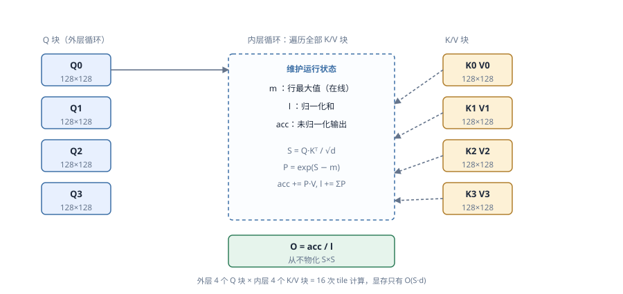

# Chapter 22. Attention Kernel Implementation

Attention 的公式只有三行：

$$
O = \text{softmax}\left(\frac{QK^T}{\sqrt{d}}\right)V
$$

但把它写成 kernel，会立刻撞上两个问题：中间矩阵 `S × S` 装不进片上存储，写回 HBM 又要读出来；decode 时每个 query 只有一行，计算量极小，却要读完整个 KV Cache。

这一章从朴素实现出发，一步一步改到 FlashAttention：怎么分块、online softmax 怎么保持正确、causal mask 怎么跳过、GQA 怎么复用 KV、decode 怎么切分 KV。第 9 章讲原理，这一章讲代码。

## 22.1 Naive Attention Implementation

最直接的实现分三个 kernel：

```text
kernel 1: S = Q K^T * scale
kernel 2: P = softmax(S)
kernel 3: O = P V
```

每个 kernel 都读写完整的 `S × S` 矩阵。

```cuda
// kernel 1: 每个线程算一个 score
__global__ void qk_gemm(const half* Q, const half* K, float* S,
                        int seq_len, int head_dim, float scale) {
  int q = blockIdx.y * blockDim.y + threadIdx.y;
  int k = blockIdx.x * blockDim.x + threadIdx.x;
  if (q >= seq_len || k >= seq_len) return;

  float acc = 0.0f;
  for (int d = 0; d < head_dim; ++d) {
    acc += __half2float(Q[q * head_dim + d]) *
           __half2float(K[k * head_dim + d]);
  }
  S[q * seq_len + k] = acc * scale;
}
```

kernel 2 按行做 softmax，kernel 3 是 `S × V` 的 GEMM。

### 为什么慢

- `S` 是 `seq_len²`，写一次、读一次、softmax 再读写一次；
- 三个 kernel 三次 launch，中间结果全部落 HBM；
- softmax 的读写完全受带宽限制；
- 没有利用 attention 的稀疏性（causal）。

对短序列（几百），这个实现还能用；对 8K 以上，HBM 流量会压垮性能。

## 22.2 Memory Cost of Attention

以 Llama 3 70B 为例：32 个 query head、8 个 KV head、head_dim 128、序列长度 8192。

单个 head 的 score 矩阵：

$$
8192 \times 8192 \times 2 \text{ bytes} = 134 \text{ MB}
$$

32 个 head：

$$
134 \text{ MB} \times 32 = 4.3 \text{ GB}
$$

如果用 FP32 存，就是 8.6 GB——一张 80 GB 的卡，光是一个 attention 层的中间矩阵就占了十分之一。

### HBM 流量

朴素实现每个 head 的流量：

- 写 `S`：134 MB；
- 读 `S` 做 softmax：134 MB；
- 写 `P`：134 MB；
- 读 `P` 做 PV：134 MB。

合计 536 MB/head，32 个 head 约 17 GB。按 3.35 TB/s 算，约 5 ms，一层。80 层就是 400 ms——还没算 GEMM 和 KV Cache 的读取。

这就是 FlashAttention 要解决的问题：不是减少 FLOPs，而是把 `S × S` 留在片上，不落 HBM。

## 22.3 Tiled Attention

分块的核心：一个 block 负责 `Br` 行 query，循环处理 `Bc` 列 key/value。

```text
for each query tile Q_i (Br × d):
    load Q_i 到 registers/shared
    initialize O_i = 0, m_i = -inf, l_i = 0
    for each key tile K_j, V_j (Bc × d):
        S_ij = Q_i K_j^T * scale        # Br × Bc，留在片上
        update m_i, l_i, O_i            # online softmax
    O_i = O_i / l_i
    write O_i
```

`S_ij` 只有 `Br × Bc`，比如 128×64，FP32 是 32 KB，完全放得进 shared memory 或寄存器。

### 复用

- `Q_i` 在整个 K/V 循环中不变，放在寄存器；
- `K_j`、`V_j` 被 `Br` 行 query 复用；
- `O_i` 累加器常驻寄存器，只在最后写回。

每个 K/V 元素从 HBM 只读一次，`S` 从不落 HBM。

### 分块大小

| 参数 | 典型值 | 约束 |
| --- | --- | --- |
| `Br` | 64–128 | 寄存器：`Br × d` 的累加器 |
| `Bc` | 32–128 | shared memory：`Bc × d` 的 K/V tile |
| `d` | 64–128 | head_dim，通常固定 |

`Br × d` 个 FP32 累加器是主要压力。128×128 就是 16,384 个 float，需要 64 KB 寄存器，单个 block 放不下，所以要拆到多个 warp。

## 22.4 Online Softmax

分块后，softmax 的分母要跨越所有 K/V tile。不能先算完所有 score 再归一化，因为 score 不保存。

Online softmax 维护三个量：

- `m`：到目前为止的最大值；
- `l`：到目前为止的指数和；
- `acc`：到目前为止的加权和。

处理新 tile 时：

$$
m' = \max(m, \max_j s_j)
$$

$$
l' = l \cdot e^{m - m'} + \sum_j e^{s_j - m'}
$$

$$
\text{acc}' = \text{acc} \cdot e^{m - m'} + \sum_j e^{s_j - m'} V_j
$$

旧的累加结果乘以 `exp(m - m')`，相当于把之前用的缩放基准从 `m` 换到 `m'`。因为 `m' >= m`，这个因子不超过 1，不会溢出。

最后：

$$
O = \frac{\text{acc}}{l}
$$

### 正确性

把 `acc` 展开：

$$
\text{acc} = \sum_j e^{s_j - m} V_j
$$

无论中间 `m` 怎么变，每次换基准都乘了对应的因子，最终结果等价于用全局最大值归一化。数学上是精确的，不是近似。

### 数值细节

- `m` 初始化为 `-inf`，第一个 tile 会把它替换掉；
- `exp(-inf - m)` 是 0，旧累加器自然清零；
- `l` 初始化为 0；
- 如果整行都是 `-inf`（全 mask），`l = 0`，除法要加保护。

## 22.5 FlashAttention Implementation

下面是一个单 block 的结构示意，省略了向量化和流水线细节：

```cuda
template <int Br, int Bc, int D>
__global__ void flash_attn(const half* Q, const half* K, const half* V,
                           half* O, int seq_len, float scale) {
  __shared__ half Ks[Bc][D];
  __shared__ half Vs[Bc][D];

  int q0 = blockIdx.x * Br;
  int head = blockIdx.y;

  // Q tile 常驻寄存器
  float q[Br][D];
  load_q_tile(q, Q, q0, head, seq_len);

  float acc[Br][D] = {0};
  float m[Br], l[Br];
  for (int i = 0; i < Br; ++i) { m[i] = -INFINITY; l[i] = 0; }

  for (int k0 = 0; k0 < seq_len; k0 += Bc) {
    load_kv_tile(Ks, Vs, K, V, k0, head, seq_len);
    __syncthreads();

    // S = Q K^T * scale，Br × Bc
    float s[Br][Bc];
    for (int i = 0; i < Br; ++i)
      for (int j = 0; j < Bc; ++j)
        s[i][j] = dot(q[i], Ks[j]) * scale;

    // online softmax + PV
    for (int i = 0; i < Br; ++i) {
      float m_new = m[i];
      for (int j = 0; j < Bc; ++j) m_new = fmaxf(m_new, s[i][j]);

      float scale_old = __expf(m[i] - m_new);
      l[i] *= scale_old;
      for (int d = 0; d < D; ++d) acc[i][d] *= scale_old;

      for (int j = 0; j < Bc; ++j) {
        float p = __expf(s[i][j] - m_new);
        l[i] += p;
        for (int d = 0; d < D; ++d)
          acc[i][d] += p * __half2float(Vs[j][d]);
      }
      m[i] = m_new;
    }
    __syncthreads();
  }

  // 写回
  for (int i = 0; i < Br; ++i)
    for (int d = 0; d < D; ++d)
      O[(q0 + i) * D + d] = __float2half(acc[i][d] / l[i]);
}
```

### 真实实现的优化

上面这个版本能跑，但离峰值很远。生产级实现还要做：

- **Tensor Core**：`QK^T` 和 `PV` 用 `mma` 指令，不是标量点积；
- **流水线**：`cp.async` 预取下一个 K/V tile，和当前计算重叠；
- **warp 分工**：一部分 warp 算 `QK^T`，一部分算 `PV`，或者按 query 行切分；
- **寄存器布局**：`acc`、`m`、`l` 的分布要和 MMA 的 fragment 对齐；
- **不写回中间 P**：`exp` 的结果直接进 `PV` 的 A 操作数，留在寄存器；
- **shared memory swizzle**：避免 K/V tile 的 bank conflict。

FlashAttention-2 调整了工作划分，减少了非矩阵乘法的开销，在 A100 上达到 50–73% 的峰值；FlashAttention-3 针对 Hopper 的 TMA 和 WGMMA 重写，接近 75%。

以 Hopper 上的实现为例，一个 block 通常分成两类 warp：

- **生产者 warp**：用 TMA 把下一个 K/V tile 搬进 shared memory，发出 barrier 信号；
- **消费者 warp**：等待 barrier，用 WGMMA 算 `QK^T` 和 `PV`，同时在 CUDA core 上做 softmax 的缩放和累加。

生产者提前一到两个 tile 预取，消费者算当前 tile，两者通过 mbarrier 同步。这样 HBM 传输、Tensor Core 计算和 softmax 的标量运算可以同时进行。没有这种重叠，任何一段等待都会直接变成算力损失。

warp 专门化也带来一个约束：消费者 warp 的寄存器要同时容纳 Q、累加器和 softmax 状态，生产者 warp 则几乎不用寄存器。寄存器分配按 block 统一，所以 tile 不能无限放大，否则消费者 warp 会 spill。

### 为什么能快

IO 复杂度从 `Θ(S²d + S²)` 降到 `Θ(S²d²/M)`，`M` 是片上存储容量。对 `d = 128`、`M ≈ 200 KB`，大约减少 6–7 倍的 HBM 流量。第 9 章有完整推导。

FLOPs 没变，甚至因为 online softmax 的 rescale 略多一点。收益全部来自访存。



图 22-1　FlashAttention 的双层循环：外层遍历 Q 块，内层遍历 K/V 块并维护在线 softmax 状态，`S×S` 从不落进 HBM

## 22.6 Causal Attention Kernel

自回归模型的 attention 是 causal 的：第 `i` 个 query 只能看到 `0..i` 的 key。

### 跳过整块

如果 query tile 从 `q0` 开始，key tile 从 `k0` 开始，当 `k0 > q0 + Br - 1` 时，整块都在对角线上方，可以完全跳过：

```cuda
int k_end = min(seq_len, q0 + Br);
for (int k0 = 0; k0 < k_end; k0 += Bc) {
  // ...
}
```

这直接把计算量减半。

### 对角块

对角块里仍然有部分元素需要 mask：

```cuda
for (int i = 0; i < Br; ++i)
  for (int j = 0; j < Bc; ++j)
    if (q0 + i < k0 + j) s[i][j] = -INFINITY;
```

被 mask 的位置 `exp(-inf) = 0`，不参与 `l` 和 `acc` 的累加。

### 负载均衡

causal 下，前面的 query tile 处理的 key 少，后面的多。如果按 `blockIdx.x` 顺序调度，前面的 block 很快完成，后面的成为长尾。

解决办法：

- 把 query tile 按工作量配对，一个 block 处理一头一尾；
- 用 persistent kernel 动态领取任务；
- 按对角线方向重新编号。

FlashAttention 的 causal 版本对 block 做了重排，让每个 SM 的工作量接近。

## 22.7 GQA and MQA Kernel Considerations

GQA 中多个 query head 共享一组 KV head：

```text
query heads:  0  1  2  3 | 4  5  6  7 | ...
KV head:          0            1
```

Llama 3 70B 是 32 个 query head、8 个 KV head，每组 4 个 query head。

### 复用 KV tile

一个 block 可以同时处理同一组的 4 个 query head：

```text
加载一次 K_j, V_j
for h in group:
    S_h = Q_h K_j^T
    online update O_h
```

K/V 的 HBM 读取量降到 1/4。如果不复用，每个 query head 都读一遍 KV，带宽浪费 4 倍。

### Decode 的 GQA

decode 时每个 query 只有一行，attention 退化成 GEMV。每个 token 要读：

$$
2 \times S \times n_{kv} \times d \times 2 \text{ bytes}
$$

`S = 8192`、`n_kv = 8`、`d = 128` 时是 33.5 MB/层，80 层约 2.7 GB/token。按 3.35 TB/s 算约 0.8 ms——只占 decode 总时间的一小部分。

序列越长，这个比例越高。128K 上下文时，KV 读取会超过权重读取，成为 decode 的主要带宽消耗。

### FlashDecoding

decode 的并行度很低：batch 个 query，每个 head 一个 block，通常填不满 GPU。

FlashDecoding 把 KV 序列切成若干 chunk，每个 chunk 一个 block，各自算部分 `(m, l, acc)`，最后用一个 reduction kernel 合并：

$$
m = \max_k m_k, \quad
l = \sum_k l_k e^{m_k - m}, \quad
\text{acc} = \sum_k \text{acc}_k e^{m_k - m}
$$

并行度从 `batch × heads` 提高到 `batch × heads × chunks`。代价是多一次 reduction 和额外的中间存储。

具体看一组数字：batch 1、32 个 head，只能填满 32 个 SM，H100 有 132 个，利用率 24%。把 8K 的 KV 切成 8 个 chunk，就有 256 个 block，足够覆盖两波。每个 block 只读 1/8 的 KV，最后 reduction 合并 8 组 `(m, l, acc)`，额外开销很小。对长上下文、低并发的 decode，这是把带宽用满的关键。

### MQA

MQA 只有 1 个 KV head，所有 query head 共享。KV 读取量是 GQA 的 `1/n_kv`，但模型质量通常略差。kernel 上的处理和 GQA 一样，只是组更大。

## 22.8 Attention Kernel Benchmarking

### 测什么

**Prefill**：计算密集，测 TFLOPS。

$$
\text{FLOPs} = 4 \times H \times S^2 \times d
$$

系数 4 是 `QK^T` 和 `PV` 各 2。causal 时乘 0.5。

H100 上 70B、`S = 8192`、`H = 32`、`d = 128`：

$$
4 \times 32 \times 8192^2 \times 128 \approx 1.1 \text{ TFLOP}
$$

一层 1.1 TFLOP，80 层 88 TFLOP。按 989 TFLOPS 峰值、50% 效率算，约 180 ms。这是 prefill 8K 上下文的理论下限。

**Decode**：带宽受限，测有效带宽。

$$
\text{bytes} = 2 \times S \times n_{kv} \times d \times 2 \times \text{batch}
$$

对 batch 1、8K 上下文，约 2.7 GB/token，理想 0.8 ms。

这两个数字对应两种完全不同的 kernel。prefill 的算术强度约为 `S/4`，8K 时是 2048，远高于 H100 的脊点 295，是 compute-bound；只有序列短于约 1,180 时才会滑到带宽受限。decode 的强度是 `n_h / n_kv`，GQA 下只有 4–8，无论序列多长都远低于脊点，永远是 bandwidth-bound。

所以“优化 attention”要分开说：prefill 优化 Tensor Core 利用率和 tile 流水线，decode 优化 KV 读取和并行度。用一个 kernel 同时服务两者，通常两边都不够好。

### 常见错误

- **忘了 scale**：`1/sqrt(d)` 漏乘，结果全错，但性能看起来正常；
- **mask 方向反了**：causal 写成上三角，训练不收敛；
- **GQA 映射错**：`kv_head = q_head % n_kv` 和 `q_head / group` 不同，前者会让同一组的 query 看到不同 KV；
- **只测方阵**：decode 的 `S=1` 和 prefill 的 `S=8192` 是完全不同的 kernel；
- **不验证边界**：序列长度不是 `Br` 的倍数时，越界读会静默出错。

### 正确性验证

用 PyTorch 的 `scaled_dot_product_attention` 做参考：

```python
ref = torch.nn.functional.scaled_dot_product_attention(q, k, v, is_causal=True)
err = (out - ref).abs().max()
```

FP16 输入的容差通常取 `1e-2` 到 `1e-3`（绝对值），因为 online softmax 的累加顺序不同。

还要单独测：

- `S = 1`；
- `S` 不是 tile 大小的倍数；
- 全 mask 的行；
- batch 和 head 数为奇数。

### 性能对比

| 实现 | 8K prefill（H100，70B 单层，causal） | 说明 |
| --- | --- | --- |
| PyTorch eager（3 个 kernel） | 6–8 ms | `S²` 矩阵落 HBM，约 5 ms 纯带宽 |
| 手写分块，无 Tensor Core | 10–20 ms | 访存少了，但算力没打满 |
| FlashAttention-2 | 0.9–1.2 ms | 接近 50–70% 峰值 |
| cuDNN / CUTLASS FMHA | 0.8–1.0 ms | 厂商调优 |

这些数字是量级，取决于实现和测量条件。重点是对比“朴素”和“IO-aware”之间的一个数量级差距。

## 本章小结

- 朴素 attention 把 `S × S` 写回 HBM，8K 序列、32 head 的中间矩阵是 4.3 GB（FP16）。
- 分块让一个 block 处理 `Br` 行 query，`S_ij` 留在片上，K/V 从 HBM 只读一次。
- Online softmax 用 `(m, l, acc)` 增量更新，换基准时乘 `exp(m - m')`，数学上精确。
- FlashAttention 的收益来自 IO 复杂度下降，FLOPs 没有减少。
- Causal attention 跳过对角线上方的整块，计算量减半；对角块要逐元素 mask。
- GQA 让多个 query head 共享 KV tile，KV 读取量降到 `1/group_size`。
- FlashDecoding 切分 KV 序列，提高 decode 的并行度。
- 基准测试要区分 prefill（TFLOPS）和 decode（有效带宽），并覆盖边界形状。

## 延伸阅读

- Dao et al., [FlashAttention: Fast and Memory-Efficient Exact Attention with IO-Awareness](https://arxiv.org/abs/2205.14135), 2022.
- Dao, [FlashAttention-2: Faster Attention with Better Parallelism and Work Partitioning](https://arxiv.org/abs/2307.08691), 2023.
- Shah et al., [FlashAttention-3: Fast and Accurate Attention with Asynchrony and Low-precision](https://arxiv.org/abs/2407.08608), 2024.
- Dao et al., [FlashDecoding](https://crfm.stanford.edu/2023/10/12/flashdecoding.html), 2023.
- Ainslie et al., [GQA: Training Generalized Multi-Query Transformer Models from Multi-Head Checkpoints](https://arxiv.org/abs/2305.13245), 2023.
- NVIDIA, [CUTLASS FMHA](https://github.com/NVIDIA/cutlass/tree/main/examples/77_blackwell_fmha).
