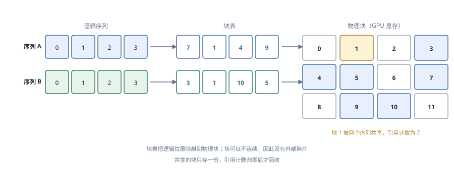

# Chapter 26. KV Cache Architecture

把 `max_model_len` 从 8K 调到 128K 之后，同一批请求全部被拒绝。原因不是算力，也不是权重：140 GB 的权重没有变，变的是每条请求的 KV Cache 预留从 2.6 GB 变成了 42 GB。8 张 H100 一共 640 GB 显存，扣掉权重只剩 500 GB，装不下 12 条这样的请求。

KV Cache（键值缓存）是推理系统里唯一随请求线性增长的内存。权重是固定成本，激活是瞬时成本，只有 KV 会在一个小时的对话里从几 MB 涨到几十 GB。它的分配方式决定了三件事：单卡能装多少并发、长上下文能不能开、以及 prefix 能不能复用。这一章从字节公式讲到块表，把这三件事算清楚。

## 26.1 KV Cache Fundamentals

自回归生成第 t 个 token 时，attention 需要前 t-1 个位置的 K 和 V。如果不缓存，每一步都要把整段前缀重新过一遍所有层。8K 上下文时，这次重算的算力是 1.24 PFLOP，其中 attention 占 88 TFLOP；缓存下来之后，每步只需要读 2.6 GB。

| 项目 | 不缓存（每步重算前缀） | 缓存（只读已有 K/V） |
| --- | --- | --- |
| 线性层 FLOPs | 1.15 PFLOP | 140 GFLOP |
| Attention FLOPs | 88 TFLOP | 21.5 GFLOP |
| 每步时间（8×H100） | 约 240 ms | 13.3 ms |
| 500 步累计 | 约 120 秒 | 6.7 秒 |
| 显存代价 | 0 | 2.6 GB/请求（8K） |

缓存的内容是每层、每个 KV 头、每个位置的 K 和 V，K 已经过 RoPE。Q 不缓存，attention 分数也不缓存——它们只服务于当前这一步。

每 token 的字节数由模型结构唯一确定：

$$
k_{kv} = 2 \cdot L \cdot n_{kv} \cdot d \cdot b
$$

前面的 2 是 K 和 V，`b` 是元素字节数。Llama 3 70B 有 80 层、8 个 KV 头、head_dim 128、FP16：

$$
k_{kv} = 2 \times 80 \times 8 \times 128 \times 2 = 327{,}680\ \text{B} = 320\ \text{KiB}
$$

| 模型 | L | n_kv | 维度 | 每 token | 8K | 128K |
| --- | --- | --- | --- | --- | --- | --- |
| Llama 3 8B | 32 | 8 | 128 | 128 KiB | 1.1 GB | 17 GB |
| Qwen2.5 7B | 28 | 4 | 128 | 56 KiB | 0.47 GB | 7.5 GB |
| Llama 3 70B | 80 | 8 | 128 | 320 KiB | 2.6 GB | 42 GB |
| DeepSeek-V3（MLA） | 61 | — | 576 | 68.6 KiB | 0.58 GB | 9.2 GB |
| 假想的 70B MHA | 80 | 64 | 128 | 2.5 MiB | 21.5 GB | 344 GB |

同一组层数和 head_dim，只把 KV 头从 8 改成 64，缓存就涨 8 倍。这就是 GQA（grouped-query attention，分组查询注意力）在推理系统里的全部意义：它不是为了算得快，而是为了装得下。DeepSeek-V3 走得更远，用多头潜在注意力（Multi-head Latent Attention，MLA）把 K/V 压成低秩表示，每 token 只剩 68.6 KiB。

## 26.2 KV Cache Memory Estimation

一个部署的 KV 预算可以写成：

$$
M_{\text{avail}} = M_{\text{gpu}} \cdot u - \frac{W}{TP} - A, \qquad
N_{\max} = \left\lfloor \frac{TP \cdot M_{\text{avail}}}{S \cdot k_{kv}} \right\rfloor
$$

`u` 是显存利用率上限（通常取 0.9），`A` 是激活、CUDA context 和 workspace 的预留，`S` 是每条请求的上下文长度。8×H100、70B、TP=8 时，每卡可用 `80 × 0.9 - 17.5 - 3 = 51.5 GB`，全系统 412 GB。

| 上下文 | 单请求 KV | 占权重的比例 | 412 GB 池的并发数 |
| --- | --- | --- | --- |
| 2K | 0.65 GB | 0.5% | 633 |
| 8K | 2.6 GB | 1.9% | 158 |
| 32K | 10.5 GB | 7.5% | 39 |
| 128K | 42 GB | 30% | 9 |

这张表解释了一个常见误判：用 640 GB 除以 140 GB，会得到 8 卡能放 4 份 70B 的结论。实际部署里通常只跑一份权重（TP=8，合计 140 GB），其余 500 GB 全部留给 KV；能放多少请求由 KV 决定。128K 上下文的单条请求，KV 已经相当于 30% 的权重。

估算时容易漏掉两项：一是块内对齐，最后一块按整块占用，实际占用略大于公式值；二是 block table、序列元数据和采样缓冲区，通常几十 MB。这两项可以精确计入，显存碎片则只能靠预留余量。

## 26.3 Static and Dynamic KV Cache

最直接的分配方式是在请求开始时按 `max_model_len` 预留。代码只有一行，后果是一整块显存被锁住，直到请求结束。

| 策略 | 预留方式 | 128 token 请求的浪费 | 增长时的代价 |
| --- | --- | --- | --- |
| 静态 max_model_len | 一次性预留 2.6 GB | 98.4% | 无 |
| 静态分桶（2K / 8K） | 按档预留 | 93.8% | 换桶要拷贝 |
| 按需分块（256 token） | 每次加 80 MiB | 50% | 分配调用频繁 |
| 容量倍增 | 不够时翻倍 | 最多 50% | 拷贝 O(S) |
| 块式（16 token） | 一次一块 5 MiB | 最多 11.7% | 每 16 token 分配一次 |

静态预留的浪费在短请求上最严重。聊天场景里大量请求只有几十个 token 的输出，却按 8K 预留，等于用 2.6 GB 装 40 MB。按需增长解决了浪费，但连续内存的增长需要“后面还有空位”，否则只能整体搬家；倍增把搬家次数压到 `O(log S)`，代价是峰值占用可能到实际需要的两倍。

分块和倍增的共同问题是：它们仍然要求一段连续内存。只要分配是连续的，增长就一定会撞上碎片。

## 26.4 Contiguous Allocation

连续分配的模型很简单：每个序列拿一段地址连续的 KV 区域，`base + pos * k_kv` 就是任意位置的地址。读取效率最高，kernel 不需要任何间接寻址。

问题出在增长和回收。一个 64 GB 的池，依次分配 20、12、20、12 GB 四个序列，池就满了；中间两个结束后，空闲总量是 24 GB，但被切成两个 12 GB 的洞。

| 时刻 | 事件 | 已用 | 空闲区间（GB） |
| --- | --- | --- | --- |
| t0 | 初始 | 0 | [64] |
| t1 | 分配 A=20、B=12、C=20、D=12 | 64 | 无 |
| t2 | B 结束 | 52 | [12] |
| t3 | D 结束 | 40 | [12, 12] |
| t4 | 新请求需要 16 GB | — | 失败：空闲 24 GB，最大连续 12 GB |

这就是外部碎片（external fragmentation）：空闲总量够，但没有一块够大。碎片率可以用“1 减去最大空闲块与空闲总量之比”衡量，上例是 50%。生产系统里这个数字随请求长度分布和到达顺序波动，长尾请求越多，碎片越难预测。

连续分配还有两个副作用。第一，扩容要搬家：8K 序列的 2.6 GB 在 3.35 TB/s 上要 0.78 ms，搬家期间这条序列不能 decode。第二，前缀无法共享：两个请求有相同的 2K 系统提示，也必须各存一份，100 条请求就是 62.5 GiB，而它们的内容完全一样。

vLLM 的论文测量过当时的系统：真正存放 token 状态的 KV 显存只占 20%–38%，其余是预留、碎片和重复。

## 26.5 Block-based Allocation

块式分配把 KV 池切成固定大小的块，按需分配。70B、块大小 16 token 时，一块是 `16 × 320 KiB = 5 MiB`。

块大小固定带来一个直接结果：任何空闲块都能满足任何请求，外部碎片消失。一个请求需要 `ceil(S / 16)` 块，最后一块可能只填了几个 token，浪费上限是 15 个 token，即 4.7 MiB。

| 块大小 | 每块字节（70B） | 内部碎片上限 | 8K 序列的块数 | 共享粒度 |
| --- | --- | --- | --- | --- |
| 8 | 2.5 MiB | 7 token / 2.2 MiB | 1,024 | 8 token |
| 16 | 5 MiB | 15 token / 4.7 MiB | 512 | 16 token |
| 32 | 10 MiB | 31 token / 9.7 MiB | 256 | 32 token |
| 64 | 20 MiB | 63 token / 19.7 MiB | 128 | 64 token |

块越小，内部碎片越少，但块表越长、间接寻址越频繁、前缀共享的粒度越细。16 是 vLLM 的默认值，在 5 MiB 的块和 2 KiB 的块表之间取了平衡：8K 序列的块表是 512 个 int32，正好 2 KiB。

```cpp
struct BlockPool {
  int32_t block_size;                 // 每块 token 数
  int32_t num_blocks;
  std::vector<int32_t> free_list;     // 空闲块 id 栈
  std::vector<int32_t> ref_count;     // 共享计数

  int32_t allocate() {
    if (free_list.empty()) return -1; // 触发抢占或拒绝
    int32_t id = free_list.back();
    free_list.pop_back();
    ref_count[id] = 1;
    return id;
  }

  void release(int32_t id) {
    if (--ref_count[id] == 0) free_list.push_back(id);
  }
};
```

这段代码只解决了“有块可用”，没有解决“块属于谁”。属于关系存在每个序列的块表里，这是下一节的内容。

## 26.6 PagedAttention

分页（paging）的核心操作是把逻辑块号翻译成物理块号。attention kernel 在遍历 KV 时多做一次查表：

```python
def paged_attention(q, pool, block_table, seq_len, block_size):
    # q: [n_kv, g, d]，g 个 Query 头共享一个 KV 头
    acc, m, l = 0.0, -inf, 0.0
    for j in range(ceil(seq_len / block_size)):
        pid = block_table[j]              # 逻辑块 -> 物理块
        k = pool.k[pid]                   # [block_size, n_kv, d]
        v = pool.v[pid]
        s = einsum("kgd,skd->skg", q, k) / sqrt(d)
        m_new = maximum(m, s.max(axis=0))
        alpha = exp(m - m_new)
        p = exp(s - m_new)
        l = l * alpha + p.sum(axis=0)
        acc = acc * alpha[..., None] + einsum("skg,skd->kgd", p, v)
        m = m_new
    return acc / l[..., None]
```

和连续版本的唯一区别是 `pid = block_table[j]`。块内仍然是连续的 5 MiB，间接寻址只发生在块边界，平均每 16 个 token 一次 int32 读取，相对于一次 5 MiB 的 K/V 搬运可以忽略。

代价在访存模式上。连续分配时，一个序列的 KV 是一段长连续内存，硬件预取和合并访问都很友好；分页之后，每个块落在池里的任意位置，跨块的访问不再连续。块越大，这种不连续越少；块越小，内部碎片越少。这个权衡没有唯一答案，取决于硬件和负载。

PagedAttention 这个名字容易让人以为它是一种新的 attention 算法。它没有改变 attention 的数学，改变的是 KV 的地址空间：从“每个序列一段连续内存”变成“每个序列一张页表”。

## 26.7 Block Tables and Logical-to-Physical Mapping

每个序列维护一张块表，外加已写入的 token 数：

```cpp
struct SequenceKV {
  std::vector<int32_t> block_table;  // 逻辑块号 -> 物理块号
  int32_t num_tokens = 0;
  int32_t block_size = 16;

  // 第 pos 个 token 的 K/V 在池中的线性槽位
  int32_t slot_of(int32_t pos) const {
    return block_table[pos / block_size] * block_size + pos % block_size;
  }

  bool need_new_block() const {
    return num_tokens % block_size == 0;
  }
};
```

一个 37 token 的序列，块表是 `[7, 12, 3]`：

| 位置范围 | 逻辑块 | 物理块 | 块内偏移 |
| --- | --- | --- | --- |
| 0–15 | 0 | 7 | 0–15 |
| 16–31 | 1 | 12 | 0–15 |
| 32–36 | 2 | 3 | 0–4 |

写入第 37 个 token 时，`slot_of(37) = 3 * 16 + 5 = 53`，物理块 3 的第 5 个槽位。逻辑上这个 token 紧挨着前一个，物理上它和前面的数据隔着两个块。位置编码用的是逻辑位置 37，不是物理槽位 53；这两个数一旦混用，输出会静默地变差。

decode 时所有请求的块表被拼成一个 `[B, max_blocks]` 的 int32 张量，配合 `context_lens` 一起传给 attention kernel。padding 到 `max_blocks` 会浪费一些显存，8K 上下文、batch 128 时是 `128 × 512 × 4 B = 256 KiB`，仍然可以忽略。



图 26-1　块表把逻辑位置映射到物理块：块可以不连续，相同前缀的块被多个序列共享，引用计数归零才回收

## 26.8 Prefix Sharing

块表是间接层，间接层意味着两个序列可以指向同一个物理块。相同的前缀只需要存一份。

| 前缀长度 | 单份 KV | 100 条独立副本 | 共享后 |
| --- | --- | --- | --- |
| 512 | 160 MiB | 15.6 GiB | 160 MiB |
| 2K | 640 MiB | 62.5 GiB | 640 MiB |
| 8K | 2.6 GB | 260 GB | 2.6 GB |

100 条各带 8K 前缀的请求，独立副本要 260 GB，占掉 412 GB 池的 63%；共享之后只剩 2.6 GB。这是前缀缓存（prefix cache）在生产里最直接的收益，尤其在 system prompt 很长、工具定义很多、或者多轮对话反复引用同一段文档的场景。

共享的实现只需要一个引用计数。两条序列的块表指向同一批块，`ref_count` 为 2；任一条结束，计数减一；计数归零才回到空闲链表。当其中一条继续生成、需要写最后一个共享块时，先复制这一块（5 MiB），再写——这叫写时复制（copy-on-write）。复制的是最后一块，不是整段前缀，所以代价从 2.6 GB 降到 5 MiB。

共享的前提是能快速判断两个前缀是否相同。常见做法是链式哈希：每个块的 key 由父块的哈希和本块的 token 组成，这样只要最后一块的哈希相同，整条链就相同。哈希碰撞需要回读 token 校验，不能只信哈希。

细节（基数树索引、驱逐顺序、跨请求的缓存命中统计）在 Chapter 27 展开。这里只需要记住：**共享之所以可能，是因为块表把“逻辑连续”和“物理连续”解耦了。**

## 26.9 KV Cache Eviction

显存不够时有四种处理方式，代价差别很大：

| 方式 | 8K 序列的代价 | 占用资源 | 适用场景 |
| --- | --- | --- | --- |
| 换出到主机内存 | 2.6 GB，PCIe 约 41 ms | PCIe、主机内存 | 稍后恢复的长上下文 |
| 重算 | 重新 prefill，约 240 ms | 算力 | 短上下文，算力有空闲 |
| 直接丢弃 | 丢失全部进度 | — | 请求已取消或低优先级 |
| 拒绝新请求 | 排队时间上升 | — | 保护已有请求的 TPOT |

换出比重算快 5–6 倍，但换出占 PCIe 带宽和主机内存，重算只占 GPU。当 decode 本来就在等带宽时，换出会进一步挤占 PCIe；当 prefill 算力有空闲时，重算几乎免费。选择取决于当前哪个资源更紧。

淘汰的粒度是块，不是序列。约束决定了哪些块可以被回收：引用计数必须为 0（没有序列还在用）、不能是正在 decode 的序列的块、如果是 prefix cache 的条目，按最近最少使用（LRU）排序。共享块的计数大于 1，必须等所有引用者都结束。

prefix cache 的淘汰还要算一笔账：块的价值等于“下次命中能省下的重算时间”。一个 2K 的前缀块被复用的概率高，重算要 60 ms；一个只出现一次的 8K 文档块，重算要 240 ms 但可能再也不来。按“重算代价 × 命中概率 / 占用字节”排序，比单纯 LRU 更合理，但需要统计信息。

## 26.10 Cache Fragmentation and Memory Reclamation

块式分配消除了外部碎片，但没有消除所有碎片：

| 碎片类型 | 来源 | 上界 | 处理方式 |
| --- | --- | --- | --- |
| 块内碎片 | 最后一块未填满 | 15 token / 4.7 MiB 每序列 | 减小块，或允许拆分尾块 |
| 块间碎片 | 块大小固定 | 0 | 不需要处理 |
| 预留碎片 | 按 max_model_len 预留 | 可达 98% | 改为按需分配 |
| 块表碎片 | 按 max_blocks 预留表项 | 2 KiB 每序列 | 表项动态增长 |

块内碎片的期望值是 `(b-1)/2` 个 token，所以 KV 利用率是：

$$
U = 1 - \frac{(b-1)/2}{S}
$$

块大小 16 时，平均浪费 7.5 个 token：

| 序列长度 | 平均浪费 | KV 利用率 |
| --- | --- | --- |
| 128 | 7.5 token | 94.1% |
| 512 | 7.5 token | 98.5% |
| 2,048 | 7.5 token | 99.6% |
| 8,192 | 7.5 token | 99.9% |

短序列的利用率明显低，但短序列本来就不占多少内存，绝对浪费是每条 2.3 MiB。真正需要关注的是池级别的指标：已分配块数、空闲块数、被引用块数、以及按序列长度加权的利用率。如果空闲块总数够、请求仍然被拒绝，说明空闲块被共享引用或预留占住了。

回收路径有四条：请求正常结束时释放全部块；引用计数归零时块回到空闲链表；显存低于水位线时触发抢占，换出或重算；进程重启时整池重建。前两条是常态，第三条决定了尾延迟，第四条决定了冷启动。

块表还带来一个额外好处：碎片整理只需要改指针。连续分配下，“把空闲区间合并”意味着搬动几十 GB 数据；块式分配下，把一个序列的块搬到另一组物理块，只需要重写它的块表，数据本身可以不动——除非目标块已经被占用，那才需要复制。**间接层把碎片整理从数据问题变成了元数据问题。**

## 本章小结

- KV Cache 缓存每层、每个 KV 头的 K 和 V，K 已经过 RoPE；它把每步从“重算整个前缀”变成“读增量”。
- 每 token 的字节数是 `2 L n_kv d b`；Llama 3 70B 是 320 KiB，8K 上下文 2.6 GB，128K 上下文 42 GB。
- 并发上限由 KV 决定，不由权重决定；8×H100 上 412 GB 的 KV 池能放 158 条 8K 请求，或 9 条 128K 请求。
- 静态预留按 max_model_len 锁住显存，短请求的浪费可达 98%；按需增长省空间，但连续内存的增长会撞上外部碎片。
- 连续分配的外部碎片来自“空闲总量够、最大连续块不够”，且无法共享前缀；vLLM 论文测得当时系统只有 20%–38% 的 KV 显存真正存了 token。
- 块式分配用固定大小消除外部碎片，内部碎片上限是 15 个 token；16 token 一块对应 5 MiB。
- 块表把逻辑位置映射到物理块，PagedAttention 只多做一次查表；写入槽位由块表计算，位置编码仍用逻辑位置。
- 引用计数让相同前缀共享物理块，写时复制只复制最后一个共享块；100 条 8K 前缀从 260 GB 降到 2.6 GB。
- 淘汰以块为单位，换出约 41 ms、重算约 240 ms（8K），选择取决于当下是 PCIe 还是算力更紧。
- 块内碎片是唯一剩下的碎片，利用率 `1 - 7.5/S`；块表让碎片整理变成改指针，而不是搬数据。

## 延伸阅读

- Kwon et al., [Efficient Memory Management for Large Language Model Serving with PagedAttention](https://arxiv.org/abs/2309.06180), SOSP 2023.
- Yu et al., [Orca: A Distributed Serving System for Transformer-Based Generative Models](https://www.usenix.org/conference/osdi22/presentation/yu), OSDI 2022.
- Zheng et al., [SGLang: Efficient Execution of Structured Language Model Programs](https://arxiv.org/abs/2312.07104), 2024.
- Prabhu et al., [vAttention: Dynamic Memory Management for Serving LLMs without PagedAttention](https://arxiv.org/abs/2405.04437), 2024.
- Qin et al., [Mooncake: A KVCache-centric Disaggregated Architecture for LLM Serving](https://arxiv.org/abs/2407.00079), 2024.
- Gim et al., [Prompt Cache: Modular Attention Reuse for Low-Latency Inference](https://arxiv.org/abs/2311.04934), 2023.
- Zhong et al., [DistServe: Disaggregating Prefill and Decoding for Goodput-optimized Large Language Model Serving](https://arxiv.org/abs/2401.09670), 2024.
- vLLM Project, [vLLM: Easy, Fast, and Cheap LLM Serving](https://github.com/vllm-project/vllm).
- FlashInfer, [FlashInfer: Kernel Library for LLM Serving](https://github.com/flashinfer-ai/flashinfer).
