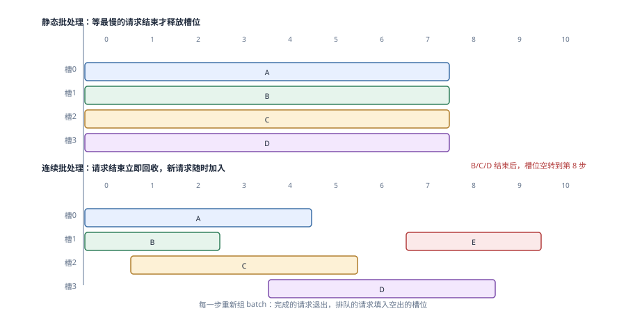

# Chapter 29. Batching and Scheduling

四个请求同时到达，输入长度分别是 128、512、1024、2048 个 token。最直接的做法是拼成一个 batch，统一补齐到 2048。这一批看起来有 4 个请求，实际只有 3,712 个有效 token，GPU 在每个位置上做的乘加有 54.7% 是浪费的；更糟的是，长度为 128 的请求要等长度为 2048 的请求生成完才能返回，尽管它自己的答案早就写完了。

调度器的工作就是避免浪费。它决定每轮把哪些请求放进 GPU、放多少 token、显存不够时牺牲谁、队列满了拒绝谁。这些决定直接改变 TTFT、TPOT 和整机吞吐，而且相互牵制：提高 batch 能摊薄权重读取，却拉长每个请求的等待；优先照顾短请求能压低平均延迟，却可能让长请求饿死。

本章从 static batching 的 padding 浪费讲起，经过 dynamic、continuous batching，落到 iteration 级的 token budget、chunked prefill、抢占和准入控制，最后讨论公平性与 SLO。

## 29.1 Static Batching

Static batching 在批次开始时确定成员，整批跑完才一起返回。张量形状是 `[B, L_max]`，短请求用 padding token 填到 `L_max`，attention mask 把 padding 位置屏蔽掉。

mask 只保证结果正确，不减少计算。GEMM 仍然按 `L_max` 的宽度算，attention 仍然为每个 padding 位置分配 query 槽位。有效利用率是：

$$
U = \frac{\sum_{i=1}^{B} l_i}{B \cdot l_{\max}}
$$

以上面四个请求为例，`U = 3,712 / 8,192 = 45.3%`，逐请求看浪费极不均匀：

| 请求 | 输入长度 | Padding | 有效占比 |
| --- | --- | --- | --- |
| A | 128 | 1,920 | 6.3% |
| B | 512 | 1,536 | 25.0% |
| C | 1,024 | 1,024 | 50.0% |
| D | 2,048 | 0 | 100% |
| 合计 | 3,712 | 4,480 | 45.3% |

KV Cache 也按 padding 后的长度分配：4 × 2048 × 320 KiB = 2.5 GiB，而实际只需要 3,712 × 320 KiB ≈ 1.13 GiB，多占 1.37 GiB。对 70B 模型，这部分显存本来可以再放两个 2K 上下文的请求。

第二个浪费来自退出时机。批次里最短的输出可能只有 10 个 token，最长的有 500 个，短请求必须陪着跑完 500 步。它的 E2E 延迟被最慢成员决定，TPOT 也会因为其他成员陆续结束、batch 变小而波动。

Static batching 并非一无是处。离线批量推理不关心单请求延迟，固定形状还能直接套 CUDA Graph；在编译型 runtime 里，它是唯一不需要重捕获图形的选择。在线服务则不能接受它的两个浪费。

## 29.2 Dynamic Batching

Dynamic batching 把“凑批”从客户端搬到服务端：请求先进入队列，服务端等待一个时间窗口 `T_w`，把窗口内到达的请求组成一批。窗口到期或 batch 达到上限就立刻执行，不再等更多请求。

窗口大小决定平均 batch。若到达率为 `λ`，忽略上限，平均 batch 约为：

```text
B ≈ λ · T_w
```

平均排队等待约为 `T_w / 2`（假设到达在窗口内均匀分布）。这两条近似解释了窗口的全部取舍：

| 窗口 | 平均排队 | 50 请求/秒时的平均 batch | 适用场景 |
| --- | --- | --- | --- |
| 2 ms | 1 ms | 0.1 | 几乎不凑批，延迟优先 |
| 10 ms | 5 ms | 0.5 | 低 QPS，凑批无效 |
| 50 ms | 25 ms | 2.5 | 中等 QPS |
| 200 ms | 100 ms | 10 | 高吞吐，延迟敏感场景不可用 |

50 请求/秒分摊到 10 ms 窗口只有半个请求。**dynamic batching 只在高 QPS 下有效**；低 QPS 时窗口内根本没有第二个请求，等待纯属浪费。这时应该把窗口调小，或者让请求直接以 batch 1 执行。

Dynamic batching 仍是 request-level：开跑后成员不能变，padding 和“等最慢成员”原样保留。按长度排序（length-aware batching）能减少 padding，但排序引入等待，也让排队时间更不均匀。生产系统只在离线做全局排序，在线只做局部长度分桶。

## 29.3 Continuous Batching

Continuous batching 把调度粒度从“一个批次”降到“一个 iteration”。一个 iteration 就是一次模型前向：对每个正在运行的序列生成一个 token，同时可以顺带处理若干 prefill。iteration 结束后，完成的序列立刻离开，新请求立刻加入，下一轮的 batch 组成与上一轮无关。

vLLM 把这一轮称为一次 scheduler step：调度器选出本轮参与的序列，model runner 执行一次 forward，采样器为每个序列取一个 token。这里的 "batch" 不再是一个固定对象，而是每轮重新计算的集合。这也是它又叫 iteration-level scheduling 的原因。

收益可以用“序列-步”来估算。四个请求的输出长度分别是 20、200、50、10：

| 策略 | 总序列-步 | 相对开销 | 短请求返回时间 |
| --- | --- | --- | --- |
| Static batching | 4 × 200 = 800 | 1.00 | 第 200 步 |
| Continuous batching | 20 + 200 + 50 + 10 = 280 | 0.35 | 第 20 步 |

序列-步少 65%，实际加速却不到 2.86 倍：单步耗时由权重和 KV 读取决定，batch 从 4 降到 1 不会线性变快；收益主要来自短请求提前释放显存。

三种策略的差别可以放在一张表里：

| 维度 | Static | Dynamic | Continuous |
| --- | --- | --- | --- |
| 调度粒度 | 整个批次 | 整个批次 | 单个 iteration |
| Padding | 有 | 有 | 无，按变长 kernel 处理 |
| 新请求加入 | 批次结束后 | 批次结束后 | 下一个 iteration |
| 完成即释放 KV | 否 | 否 | 是 |
| 主要收益 | 图形固定 | 提高 batch | 消除头阻塞 |
| 典型场景 | 离线评测 | 中高 QPS | 在线服务 |

## 29.4 Iteration-level Scheduling

Iteration-level 调度器的主循环每轮做五件事：回收完成的序列、按优先级挑出 decode、用剩余预算装入 prefill、调用 model runner、把采样结果写回序列并流式输出。

```python
def scheduler_loop(engine):
    while not engine.stopped:
        for seq in engine.running.pop_finished():
            engine.kv.free(seq)
            engine.output.finish(seq)

        budget = TokenBudget(engine.max_num_batched_tokens)
        batch = Batch()

        # decode 优先：每个运行中的序列占 1 个 token
        for seq in engine.running.by_priority():
            if budget.take(1):
                batch.add_decode(seq)

        # 剩余预算给 prefill，一次只装一个 chunk
        while engine.waiting and budget.remaining > 0:
            seq = engine.waiting.peek()
            n = min(seq.prefill_remaining, budget.remaining)
            if not engine.kv.can_allocate(seq, n):
                if not engine.preempt_one(batch):
                    break
                continue
            engine.kv.allocate(seq, n)
            batch.add_prefill(seq, n)
            budget.take(n)
            if seq.prefill_remaining == 0:
                engine.waiting.pop()
                engine.running.add(seq)

        out = engine.model_runner.execute(batch)
        for seq, token in zip(batch.sequences, out.tokens):
            seq.append(token)
            engine.output.push(seq, token)
            if seq.should_stop(token):
                seq.mark_finished()
```

这段伪代码省略了采样、停止条件和错误路径，但保留了三个关键顺序：先回收、再 decode、最后 prefill。顺序不能反：prefill 一次可能占几千个 token 的预算，如果排在 decode 前面，正在生成的请求会被迫等一整轮，TPOT 出现尖刺。

本轮耗时记为 `T_iter`。对纯 decode 轮次，`T_iter` 约等于 TPOT；对混批轮次，它是 prefill 计算和 decode 带宽读取的较大者。TTFT 则是排队时间加上 `ceil(L / C)` 个 prefill 轮次，`C` 是每轮 chunk 大小。

调度器本身必须快。一轮 `T_iter` 是几十毫秒，调度逻辑的 CPU 时间应控制在 1 ms 以内；在 Python 里遍历上万个请求、做复杂的打分，会直接吃掉 GPU 的空闲窗口。



图 29-1　静态批处理与连续批处理：静态批的槽位要等最慢的请求结束，连续批每一步重新组 batch，完成的请求立刻让出槽位

## 29.5 Chunked Prefill

以 8 卡 TP 部署、聚合有效算力 3 PFLOPS 为例，一个 8K token 的 prefill 中，线性层约 `2 × 70e9 × 8192 ≈ 1.15 PFLOP`，attention 约 88 TFLOP，合计约 1.24 PFLOP，需要约 410 ms。如果它独占一轮，所有正在 decode 的请求都要停 410 ms，TPOT 从 40 ms 跳到 450 ms，交互体验立刻崩掉。

Chunked prefill 把长 prompt 切成固定大小的块，每轮只算一块，和 decode 混在同一个 batch 里。切分后，单轮的计算量被压到预算以内，decode 的节奏不被打断。块大小 `C` 的上界由 TPOT 目标决定：

$$
C \le \frac{(T_{\text{slo}} - T_{\text{decode}}) \cdot P_{\text{eff}}}{e_{\text{tok}}}
$$

其中 `e_tok = 2P = 140 GFLOP` 是每 token 的线性层计算量（attention 另占约 7%），`T_decode` 是本轮 decode 部分的耗时。取 `T_slo = 100 ms`、`T_decode = 18 ms`、`P_eff = 3 PFLOPS`，得到 `C ≤ 1,757`，实际取 1024。

| Chunk | 每轮计算 | 8K 需要轮数 | 每轮计算时间 | 对 decode 的干扰 |
| --- | --- | --- | --- | --- |
| 256 | 35.8 TFLOP | 32 | 12 ms | 很低 |
| 512 | 71.7 TFLOP | 16 | 24 ms | 低 |
| 1,024 | 143 TFLOP | 8 | 48 ms | 中 |
| 2,048 | 287 TFLOP | 4 | 96 ms | 高 |

块不是免费的。每个 chunk 都要对之前所有 KV 做 attention，后面的块计算量略高于前面的块；切得越碎，attention 的重复读取越多，总计算量略升。更直接的成本是 TTFT：一个 8K 请求被切成 8 块，如果每块都要和其他请求分享一轮，它的首 token 要等 8 轮，可能比独占一轮更慢。

所以 chunked prefill 的适用条件是“系统里已经有 decode 流量”。空载时，独占一轮 prefill 最快；负载很高时，切块是保护 TPOT 的必要手段。多数引擎把它做成可配置项，并按当前运行序列数自动启用。

## 29.6 Token Budget Scheduling

Token budget 是每轮允许处理的 token 总数，包括所有 decode 的 1 个 token 和所有 prefill chunk 的长度。它把“每轮跑多久”从不可控变成可计算：

```text
D + Σ C_j ≤ B_total
```

`D` 是 decode 序列数。预算确定后，prefill 只能使用剩余部分，调度器据此决定这一轮装几个新请求、每个请求切多大。

| 每轮预算 | 并发 decode | 可用于 prefill | 估算迭代时间 | 适用 |
| --- | --- | --- | --- | --- |
| 2,048 | 0 | 2,048 | 96 ms | 离线吞吐 |
| 2,048 | 512 | 1,536 | 92 ms | 交互服务 |
| 4,096 | 1,024 | 3,072 | 185 ms | 混合负载 |
| 8,192 | 512 | 7,680 | 390 ms | 高吞吐批处理 |

预算不是越大越好。8,192 的预算在 512 路 decode 下仍留出 7,680 个 prefill token，单轮接近 390 ms，所有 decode 请求的 TPOT 一起被拖到 390 ms。反过来，预算太小会让 prefill 排队，TTFT 变长。正确的做法是从 SLO 反推：先由 29.5 的公式算出单轮可承受的 prefill token 数，再加上 decode 数，得到预算。

预算还要和 KV 显存一起检查：一个 32K 请求即使只算 1,024 token 的 chunk，也要先有容纳全部 KV 的块；显存不足时预算再大也装不进去，进入抢占逻辑。

## 29.7 Preemption and Re-computation

显存不够时，调度器必须让某个正在运行的序列让位。两种做法：recompute 把它的 KV 全部丢弃，放回等待队列，之后重新 prefill；swap 把 KV 复制到 CPU 的 pinned memory，之后再复制回来。

按每 token 320 KiB、线性层 140 GFLOP 计，各上下文的代价如下（PCIe 带宽 50 GB/s，有效算力 3 PFLOPS）。recompute 列只计线性层；加上 attention 后，8K 的真实重算约 412 ms，32K 约 2 秒，因为 attention 的 FLOPs 随上下文平方增长。

| 上下文 | KV 大小 | Swap 耗时 | Recompute 耗时 |
| --- | --- | --- | --- |
| 2K | 640 MiB | 13.4 ms | 96 ms |
| 8K | 2.5 GiB | 53.7 ms | 383 ms |
| 32K | 10 GiB | 214 ms | 1,533 ms |

单位 token 的对比更清楚：

$$
\frac{T_{\text{swap}}}{T_{\text{recompute}}} =
\frac{320 \text{ KiB} / 50 \text{ GB/s}}{140 \text{ GFLOP} / 3 \text{ PFLOPS}}
= \frac{6.55\ \mu s}{46.7\ \mu s} \approx 0.14
$$

孤立地看，swap 便宜约 7 倍。但 swap 占用 host memory，而且所有序列共享同一条 PCIe；10 个 8K 序列同时 swap 就是 25 GiB 的搬运，耗时超过半秒。Recompute 消耗的是 GPU 算力，可以和 decode 的带宽空闲重叠，还能复用 prefix cache 中仍然有效的块。

这解释了为什么 vLLM 默认选择 recompute，而把 swap 留给“上下文极长、host memory 充足、PCIe 空闲”的场景。选择不是看单次耗时，而是看资源池：算力紧张时 swap，PCIe 和内存紧张时 recompute。

抢占规则通常是优先牺牲“最近加入、优先级最低”的序列，因为它已生成的 token 最少。更细的粒度是只回收最后若干个 block，保留 prefix，重算时只补被回收的部分。无论哪种，都要记录 `preemption_count`；反复被抢占说明准入过量，应该拒绝新请求而不是继续抖动。

## 29.8 Priority Scheduling

在线服务里，请求并不平等。交互式补全要求 TTFT 在 500 ms 内，离线摘要可以等 30 秒。调度器用优先级区分它们：

| 级别 | 名称 | TTFT 目标 | TPOT 目标 | 可被抢占 | 例子 |
| --- | --- | --- | --- | --- | --- |
| P0 | interactive | 500 ms | 50 ms | 否 | 代码补全、聊天 |
| P1 | standard | 2 s | 100 ms | 是 | 普通 API |
| P2 | batch | 30 s | 500 ms | 是 | 离线摘要、评测 |

实现上是一个按 `(priority, arrival_time)` 排序的堆。decode 序列始终优先于等待中的 prefill，因为 decode 已经占着 KV，中断它的代价最高。高优先级请求到达时，调度器可以立即抢占一个低优先级序列，把它的块让出来。

纯优先级会让低级别请求饿死。持续的 P0 流量下，P2 可能几小时拿不到一块显存。解决办法是 aging：等待时间每超过一个阈值，有效优先级提升一级：

```text
p_eff = p_base + floor(wait_ms / 1000)
```

另一个约束是预留。给 P0 预留 20% 的 KV 块，P1/P2 不得占用；否则突发流量到来时，高优先级请求也会因为显存耗尽而排队。预留的代价是低优先级可用容量变小，需要按流量比例调。

优先级和 token budget 互相影响：高优先级 prefill 会压缩低优先级 decode 的 token 数。生产系统给每个级别单独的预算配额，而不是全局均分。

## 29.9 Admission Control

准入控制决定“接不接”。它在请求进入等待队列之前估算资源需求，超出能力就尽早拒绝，而不是让请求在队列里等到超时。

最硬的约束是 KV 显存。一个请求至少需要 `(prompt_len + max_new_tokens) × 320 KiB` 的空间。若可用 KV 池为 `M_kv`，平均上下文为 `L_avg`，最大并发约为：

```text
N_max = M_kv / (L_avg × 320 KiB)
```

按 52.5 GB 的 KV 池计算：

| 平均上下文 | 每序列 KV | N_max | 留 20% 余量后 |
| --- | --- | --- | --- |
| 2K | 640 MiB | 84 | 67 |
| 4K | 1.25 GiB | 42 | 34 |
| 8K | 2.5 GiB | 21 | 17 |
| 32K | 10 GiB | 5 | 4 |

这只是显存上限。实际并发还受 SLO 约束：利用率超过 80% 后延迟快速上升，有效并发应取 `0.8 × N_max`。如果每秒到达 `λ` 个请求、每个请求平均停留 `W` 秒，Little's Law 给出所需并发 `L = λW`；`L` 超过 `0.8 × N_max` 时，要么扩容，要么拒绝。

拒绝要带信息：返回 429 并给出 `Retry-After`，让客户端退避；超过长度上限的输入直接返回 400；有时限的请求在入队时估算等待，超过 deadline 就提前失败。早失败比晚超时更有用。

准入还要防止“大请求挤爆”。一个 128K 上下文的请求会占掉几十个普通请求的显存，即使它只占一个并发槽。按 token 计费、设上下文上限、为大请求单独排队，都是常见做法。

## 29.10 Fairness and Quality of Service

调度器的最终目标不是吞吐，而是 goodput：单位时间内 TTFT 和 TPOT 都达标的完成请求数。

| 业务类型 | TTFT p99 | TPOT p99 | 说明 |
| --- | --- | --- | --- |
| 交互补全 | 500 ms | 50 ms | 用户盯着光标 |
| 聊天 | 1 s | 80 ms | 首 token 后可以持续阅读 |
| 离线摘要 | 30 s | 500 ms | 只关心完成时间 |
| 批量评测 | 不约束 | 不约束 | 只关心总时长 |

TTFT 由排队和 prefill 决定，TPOT 由 decode 的 batch 和 KV 读取决定。多装 prefill 压低 TTFT，却拉长 TPOT；限制 prefill 稳住 TPOT，却推高 TTFT。预算必须显式分配，不能让先到的请求自然占满。

公平性解决另一类问题：多租户共享引擎时，一个租户的长请求不能挤掉其他人的短请求。常用机制：

| 机制 | 解决的问题 | 代价 |
| --- | --- | --- |
| 加权公平队列 | 按权重分配 token 预算 | 需要维护每个租户的队列 |
| 每租户配额 | 防止单租户占满并发 | 空闲配额无法借用时利用率下降 |
| Aging | 防止低优先级饿死 | 高优先级延迟略微上升 |
| 长度分桶 | 减少 padding 和长短混排 | 分桶边界附近等待增加 |
| 最大抢占次数 | 防止抖动 | 超限请求被拒绝 |

可操作的组合：按租户用加权公平队列分配 token budget，队列内按优先级排序，等待过久则 aging，连续被抢占则拒绝并让客户端重试。它不保证每个请求达标，但能避免无限期推迟和单租户独占。

衡量公平性要看按租户统计的 p99 TTFT 和超时率；某个租户的 p99 是别人的 10 倍，问题在配额配置，不在机器。

## 本章小结

- Static batching 用 padding 对齐到最长序列，四个长度 128/512/1024/2048 的请求利用率只有 45.3%，KV 也多占 1.37 GiB；短请求还要等最慢成员结束。
- Dynamic batching 用时间窗口凑批，平均 batch 约 `λ·T_w`，低 QPS 下窗口无效；它仍然是 request-level，padding 和头阻塞没有解决。
- Continuous batching 以 iteration 为调度单位，完成的序列立刻退出，新请求下一轮加入；序列-步从 800 降到 280，但实际加速受单步带宽限制。
- Chunked prefill 把长 prompt 切块与 decode 混批，块大小由 TPOT 目标反推；8K prefill 的线性层约 1.15 PFLOP、attention 约 88 TFLOP，100 ms 目标下每轮约 1,024 token。
- Token budget 同时约束 decode 和 prefill，预算应从 SLO 反推，并与 KV 显存检查配合。
- 显存不足时 recompute 丢弃 KV 重算，swap 把 KV 换到 host；单次 swap 便宜约 7 倍，但 PCIe 和 host memory 是共享资源，默认策略通常是 recompute。
- 优先级调度要配合 aging 和预留，避免低优先级饿死；准入控制按 KV 和 SLO 估算并发，早拒绝优于晚超时。
- 生产目标是 goodput 和按租户的 p99，不是裸吞吐；公平性需要配额、aging 和抢占上限共同保证。

## 延伸阅读

- Yu et al., [Orca: A Distributed Serving System for Transformer-Based Generative Models](https://www.usenix.org/conference/osdi22/presentation/yu), OSDI 2022.
- Kwon et al., [Efficient Memory Management for Large Language Model Serving with PagedAttention](https://arxiv.org/abs/2309.06180), SOSP 2023.
- Agrawal et al., [Sarathi-Serve: Efficient LLM Inference via Chunked Prefills and Decode-Maximal Batching](https://arxiv.org/abs/2403.02310), OSDI 2024.
- Wu et al., [Fast Distributed Inference Serving for Large Language Models](https://arxiv.org/abs/2305.05920), 2023.
- Zhong et al., [DistServe: Disaggregating Prefill and Decoding for Goodput-optimized Large Language Model Serving](https://arxiv.org/abs/2401.09670), OSDI 2024.
- Sun et al., [Llumnix: Dynamic Scheduling for Large Language Model Serving](https://arxiv.org/abs/2406.03243), OSDI 2024.
- vLLM, [Scheduler source](https://github.com/vllm-project/vllm/blob/main/vllm/core/scheduler.py).
- NVIDIA, [TensorRT-LLM Batch Manager](https://nvidia.github.io/TensorRT-LLM/).
