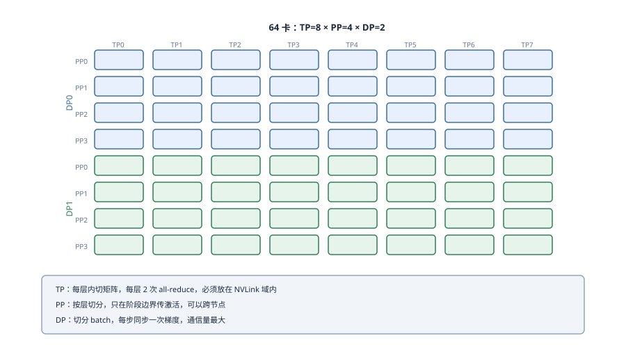

# Chapter 34. Model Parallelism

70B 模型的 FP16 权重是 140 GB，一张 80 GB 的卡放不下。最直接的解法是把权重切开，每张卡放一部分——但切法不同，通信量差一个数量级。

按层切，两个 stage 之间只传激活，通信量小，但 GPU 会轮流空转；按矩阵切，每层都要 all-reduce，通信量大，但并行度高。数据并行、张量并行、流水并行、序列并行、上下文并行、专家并行，解决的是不同维度的问题，实际系统通常组合使用。

这一章把每种并行的切分方式、显存收益和通信量算清楚，最后给出选择策略。

## 34.1 Data Parallelism

数据并行（data parallelism，DP）复制完整模型，每个 rank 处理不同的数据分片，反向传播后对梯度做 all-reduce。

```text
rank 0: 完整模型 + batch 0 ──┐
rank 1: 完整模型 + batch 1 ──┼── all-reduce 梯度 ── 更新
rank 2: 完整模型 + batch 2 ──┤
rank 3: 完整模型 + batch 3 ──┘
```

### 显存

每个 rank 都要放下完整模型、梯度、优化器状态和激活。以 7B、BF16、Adam 为例：

| 项目 | 每参数字节 | 7B 占用 |
| --- | --- | --- |
| 权重（BF16） | 2 | 14 GB |
| 梯度（BF16） | 2 | 14 GB |
| FP32 master 权重 | 4 | 28 GB |
| Adam 一阶动量 | 4 | 28 GB |
| Adam 二阶动量 | 4 | 28 GB |
| 合计 | 16 | 112 GB |

一张 80 GB 的卡放不下。这就是 ZeRO 的动机。

### ZeRO

ZeRO 把优化器状态、梯度、参数分片到 `N` 个 rank：

| 阶段 | 分片内容 | 7B、N=8 每卡 |
| --- | --- | --- |
| ZeRO-1 | 优化器状态 | 14 + 14 + 84/8 = 38.5 GB |
| ZeRO-2 | 优化器状态 + 梯度 | 14 + 14/8 + 84/8 = 26.25 GB |
| ZeRO-3 | 优化器状态 + 梯度 + 参数 | 14/8 + 14/8 + 84/8 = 14 GB |

代价是通信：ZeRO-3 在前向和反向都要 all-gather 参数，通信量约为标准 DP 的 1.5 倍。

### 推理中的 DP

推理不做梯度更新，DP 就是“每个副本独立服务请求”。它线性扩展吞吐，但每个副本都要完整权重。对 70B，8 个副本需要 8 张卡，模型仍然放不下——所以推理的 DP 必须建立在模型已经能放进单卡的前提下，或者和 TP 组合。

## 34.2 Tensor Parallelism

张量并行（tensor parallelism，TP）把单个矩阵乘切开，每个 rank 算一部分，最后合并。

### 列并行

权重按输出维切：

$$
W = \begin{bmatrix} W_1 \\ W_2 \end{bmatrix}, \quad
Y = XW = \begin{bmatrix} XW_1 & XW_2 \end{bmatrix}
$$

每个 rank 拿到 `W_i`，计算 `XW_i`，输出在列方向拼接。GEMM 本身不需要通信，只有后续操作需要。

QKV 投影按 head 切：64 个 query head 分到 8 个 rank，每个 rank 8 个 head；KV head 也按同样方式切。attention 在每个 rank 内部独立完成。

### 行并行

权重按输入维切：

$$
W = \begin{bmatrix} W_1 & W_2 \end{bmatrix}, \quad
Y = XW = X_1 W_1 + X_2 W_2
$$

每个 rank 算一个部分和，最后 all-reduce 求和。

### 一个 Transformer 层

```text
输入 X
  │
  ├─ column parallel: QKV 投影（按 head 切）
  │    每个 rank 算自己的 head，attention 本地完成
  │
  ├─ row parallel: 输出投影
  │    每个 rank 算部分和 → all-reduce
  │
  ├─ column parallel: gate/up 投影
  │    SwiGLU 本地完成
  │
  └─ row parallel: down 投影
       每个 rank 算部分和 → all-reduce
```

每层两次 all-reduce（attention 输出、MLP 输出），每次的数据量是 `B × S × hidden × 2` 字节。

### 通信量

以 70B、TP=8、prefill `B=1, S=8192`、hidden 8192、FP16 为例：

- 激活大小：`8192 × 8192 × 2 = 128 MB`；
- ring all-reduce 每 rank 搬运 `1.75 × 128 MB = 224 MB`；
- 每层 2 次，80 层：`2 × 80 × 224 MB = 35.8 GB`；
- NVLink 900 GB/s 下约 40 ms。

prefill 计算约 240 ms，通信占 14% 左右。可以接受，但已经不是零头。

decode 时 `S=1`，激活只有 16 KB，all-reduce 几乎免费；TP 的代价主要在 prefill 和训练。

### TP 的规模上限

TP 每层都要 all-reduce，延迟随 rank 数增长。节点内 NVLink 可以做到 TP=8；跨节点 50 GB/s 时，同样的 all-reduce 慢 18 倍，TP 通常不超过 8。

例外是模型大到单节点放不下，必须跨节点 TP，这时要接受更低的效率。

### 代码示意

```cpp
// 列并行：每个 rank 取输出维的一段
Tensor shard_columns(const Tensor& w, int rank, int tp) {
  int64_t per = w.shape[0] / tp;
  return w.slice(0, rank * per, per);
}

// 行并行：每个 rank 取输入维的一段，算完 all-reduce
Tensor row_parallel_linear(const Tensor& x, const Tensor& w,
                           ncclComm_t comm) {
  Tensor partial = matmul(x, w.shard_input(rank, tp));
  ncclAllReduce(partial.data, partial.data, partial.numel(),
                ncclFloat16, ncclSum, comm, stream);
  return partial;
}
```

真实实现还要处理 bias（只在 rank 0 加）、RoPE（每个 rank 只算自己的 head）和 KV Cache 的 head 布局。

## 34.3 Pipeline Parallelism

流水并行（pipeline parallelism，PP）按层切：

```text
stage 0: layers 0–19   → stage 1: layers 20–39
stage 1                → stage 2: layers 40–59
stage 2                → stage 3: layers 60–79
```

每个 stage 放在不同 GPU 上，stage 之间只传激活，通信量是 `B × S × hidden × 2`，点对点，不需要 all-reduce。

### 气泡

朴素的流水线在填充和排空阶段有空闲：

$$
\text{bubble ratio} = \frac{p - 1}{m + p - 1}
$$

`p` 是 stage 数，`m` 是 microbatch 数。`p=4, m=8` 时是 `3/11 = 27%`；`m=32` 时降到 `3/35 = 8.6%`。

增加 `m` 能减少气泡，但每个 microbatch 变小，GEMM 效率下降，激活显存也增加。

### 1F1B

1F1B（one forward, one backward）让每个 stage 在前向和反向之间交替，减少同时驻留的激活：

```text
warmup:   F F F
steady:   F B F B ...
cooldown: B B B
```

它在稳态下每个 stage 只保留一个 microbatch 的激活，显存比“全前向再全反向”低得多。

### 交错式流水线

把每个 stage 再切成若干虚拟 stage：

```text
GPU0: stage 0a, stage 2a
GPU1: stage 0b, stage 2b
...
```

这样气泡更小，但通信次数增加。Megatron 的 interleaved schedule 属于这一类。

### PP 的适用场景

- 模型层数多、单层能放进一张卡；
- 跨节点带宽低，TP 不划算；
- 训练时追求吞吐，能接受气泡。

推理的 PP 较少用：decode 每步只有 1 个 token，流水线填充开销占比高，除非并发请求足够多。

## 34.4 Sequence Parallelism

TP 之后，LayerNorm、dropout、残差这些逐位置操作在每个 rank 上重复计算了完整的 `S × hidden` 激活。序列并行（sequence parallelism，SP）把它们按序列维切开：

```text
TP: 每个 rank 有完整的 S，但只算部分 head
SP: 每个 rank 只算 S/N 个位置
```

在 LayerNorm 前后插入 all-gather 和 reduce-scatter，把激活显存从 `S × hidden` 降到 `S/N × hidden`。

Megatron-SP 的做法是：

- column parallel 之后 all-gather，恢复完整序列；
- row parallel 之前 reduce-scatter，切回分片。

它不减少 GEMM 的通信，只减少 norm/dropout 的重复计算和激活显存。训练大模型时，这部分激活往往不可忽略。

## 34.5 Context Parallelism

上下文并行（context parallelism，CP）按序列维切 attention：

```text
rank 0: token 0..S/N-1
rank 1: token S/N..2S/N-1
...
```

每个 rank 持有自己那段 Q，但 attention 需要所有 K/V。两种做法：

- **Ring attention**：K/V 块沿环传递，每个 rank 依次和所有块算 attention，用 online softmax 合并；
- **All-gather K/V**：先把 K/V 收集全，再本地算 attention，通信量更大但实现简单。

CP 的通信量是 `O(S × d)` 每层，和 TP 的 `O(B × S × hidden)` 同阶，但只在 attention 内部发生。它适合超长上下文（128K 以上），此时单卡 KV 放不下，TP 又切不了序列维。

负载均衡要注意 causal mask：前面的 rank 看到的 key 少，后面的多。常见做法是把序列按“头尾配对”分配，让每个 rank 的工作量接近。

## 34.6 Expert Parallelism

专家并行（expert parallelism，EP）把 MoE 的专家分到不同 rank：

```text
rank 0: experts 0–31
rank 1: experts 32–63
...
```

每个 token 经过 router 后，被送到对应的专家所在 rank：

```text
dispatch:  token → all-to-all → 专家
combine:   专家输出 → all-to-all → 原 rank
```

### 通信量

每个 token 激活 `k` 个专家，dispatch 和 combine 各一次 all-to-all。DeepSeek-V3 每 token 的 all-to-all 数据量约 6.7 MB，跨节点 50 GB/s 下约 134 μs，一层。几十层累积起来，通信占比很高。

### 负载均衡

专家并行最怕路由不均：某个专家收到 10 倍的 token，它所在 rank 成为瓶颈，其他 rank 空等。

对策：

- capacity factor：每个专家最多接收 `C = capacity_factor × kT/E` 个 token，超出部分丢弃或走残差；
- aux loss：训练时惩罚路由分布的方差；
- DeepSeek 的无辅助损失偏置：根据负载动态调整专家的路由分数；
- 动态冗余：把热点专家复制到多个 rank。

### EP 与 TP 的关系

EP 切的是专家维，TP 切的是单个专家的矩阵。MoE 层通常 EP 在外、TP 在内：

```text
EP=8: 8 组专家
每组内 TP=4: 单个专家的权重再切 4 份
```

这样 all-to-all 只在 EP 组之间发生，专家内部的计算用 TP 加速。

## 34.7 Hybrid Parallelism

实际训练/推理用多维组合：

```text
节点内: TP=8
节点间: PP=4
数据副本: DP=2
总卡数: 8 × 4 × 2 = 64
```

或者 MoE 模型：

```text
TP=8（节点内）
EP=8（跨节点）
PP=2
DP=1
```

### 选择顺序

1. **先让模型放下**：优先 TP（节点内），不够再 PP；
2. **再看通信**：TP 不超过节点内 GPU 数；PP 跨节点；
3. **最后扩吞吐**：DP 复制副本，EP 扩展专家。

### 一个 70B 的例子

70B FP16 140 GB，8×80 GB 节点：

- TP=8：每卡 17.5 GB 权重，KV 和激活有充足余量；
- 若节点只有 4 卡：TP=4，每卡 35 GB，仍然可行；
- 跨节点：PP=2，每个 stage TP=4，总 8 卡；stage 间传激活，通信量小；
- 推理若要更高吞吐：再加 DP 副本，每个副本独立 TP=8。



图 34-1　64 卡的混合并行布局：TP 组放在 NVLink 域内，PP 组跨节点只传激活，DP 组每步同步一次梯度

## 34.8 Parallelism Strategy Selection

| 策略 | 切分维度 | 显存收益 | 通信 | 适用 |
| --- | --- | --- | --- | --- |
| DP | batch | 无（复制） | 梯度 all-reduce | 吞吐扩展 |
| TP | hidden/head | 高 | 每层 2 次 all-reduce | 节点内，模型放不下 |
| PP | 层 | 高 | stage 间点对点 | 跨节点，层数多 |
| SP | 序列（norm 等） | 中 | all-gather/reduce-scatter | 训练激活优化 |
| CP | 序列（attention） | 高 | ring/all-gather KV | 超长上下文 |
| EP | 专家 | 高 | all-to-all | MoE |

### 决策树

```text
模型能放进单卡？
├── 是：DP 扩吞吐；长上下文加 CP
└── 否：
    ├── 单节点能放下？→ TP=节点 GPU 数
    └── 单节点放不下：
        ├── 层数多、跨节点带宽低 → PP
        └── MoE → EP + TP
```

### 关键约束

- **TP 的通信量随 `S` 增长**，prefill 比 decode 更敏感；
- **PP 的气泡随 `p` 增长**，需要足够的 microbatch；
- **EP 的 all-to-all 对负载均衡极敏感**；
- **CP 的 KV 交换量随 `S` 增长**，但只在 attention 内；
- **DP 最简单**，但要求单卡放得下完整模型。

没有“最优并行”，只有在给定模型、集群拓扑和 SLO 下的最合适组合。

## 本章小结

- DP 复制模型，解决吞吐不解决显存；ZeRO 通过分片优化器状态、梯度和参数把 7B 的训练显存从 112 GB 降到 14 GB（N=8）。
- TP 按矩阵维度切，列并行无通信、行并行 all-reduce；每层 2 次 all-reduce，70B prefill 8K 的通信约占 14%。
- TP 的规模受互连限制，节点内通常不超过 8。
- PP 按层切，通信量小但有气泡；气泡比例 `(p-1)/(m+p-1)`，1F1B 和交错调度能缓解。
- SP 切 norm/dropout 的序列维，减少激活显存；CP 切 attention 的序列维，服务超长上下文。
- EP 切专家，all-to-all 是主要开销；负载均衡靠 capacity factor、aux loss 和动态冗余。
- 实际系统用 TP×PP×DP×EP 的多维组合，选择顺序是先放下、再省通信、最后扩吞吐。

## 延伸阅读

- Shoeybi et al., [Megatron-LM: Training Multi-Billion Parameter Language Models Using Model Parallelism](https://arxiv.org/abs/1909.08053), 2019.
- Rajbhandari et al., [ZeRO: Memory Optimizations Toward Training Trillion Parameter Models](https://arxiv.org/abs/1910.02054), SC 2020.
- Huang et al., [GPipe: Efficient Training of Giant Neural Networks using Pipeline Parallelism](https://arxiv.org/abs/1811.06965), 2018.
- Narayanan et al., [Efficient Large-Scale Language Model Training on GPU Clusters Using Megatron-LM](https://arxiv.org/abs/2104.04473), 2021.
- Korthikanti et al., [Reducing Activation Recomputation in Large Transformer Models](https://arxiv.org/abs/2205.05198), 2022.
- Liu et al., [Ring Attention with Blockwise Transformers for Near-Infinite Context](https://arxiv.org/abs/2310.01889), 2023.
- DeepSeek-AI, [DeepSeek-V3 Technical Report](https://arxiv.org/abs/2412.19437), 2024.
