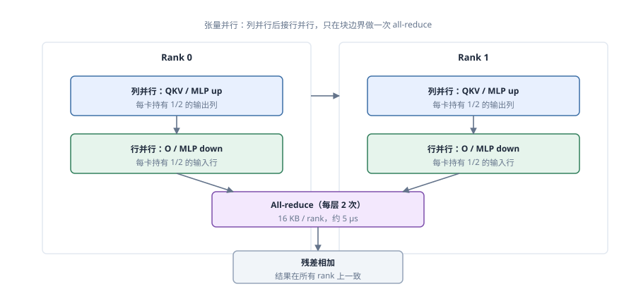

# Chapter 35. Distributed Inference

70B 模型在 8 卡上跑起来，和“在 8 卡上跑得快”是两件事。权重切分只解决了放得下；decode 每一步都要做 all-reduce，prefill 的激活要跨 stage 传输，KV 要分布在各卡上，请求还要路由到正确的副本。分布式推理的难点不在单卡 kernel，而在这些跨设备的协调。

这一章讲部署形态：模型怎么分片加载、TP/PP/EP 在推理时各自付出什么代价、KV 怎么分布和迁移、prefill/decode 为什么要分离，以及多节点服务怎么路由和容错。

## 35.1 Distributed Model Loading

### 分片规则

每个 rank 按并行策略加载自己那一份：

```text
TP 列并行：按输出维切，rank i 取 [i*N/tp, (i+1)*N/tp)
TP 行并行：按输入维切
PP：按层切，rank i 取 layers[i*L/pp, (i+1)*L/pp)
EP：按专家编号切
```

加载器要先读 `config.json` 和并行配置，算出每个张量的切片范围，再逐张量映射。

### 并行加载

8 个 rank 同时从同一块 NVMe 读同一个文件，会争抢带宽。两种做法：

- **每个 rank 读自己的分片**：safetensors 支持按 offset 随机读，8 个 rank 各读 1/8，总时间接近单卡；
- **rank 0 读全量再分发**：简单，但 rank 0 成为瓶颈，还要额外的 H2D/NVLink 传输。

生产环境通常用第一种，并配合 page cache 预热。

### 一致性

所有 rank 必须用同一份 config、同一份权重、同一个 tokenizer。加载完成后做一次集合校验：

```python
# 每个 rank 计算自己分片的校验和，all-gather 后比对预期
local_sum = checksum(shard)
all_sums = all_gather(local_sum)
assert all_sums == expected_sums
```

权重版本不一致是分布式推理最隐蔽的故障之一：每个 rank 单独看都正常，输出却在某些 token 上漂移。

### 冷启动

70B FP16 140 GB，8 卡各读 17.5 GB。NVMe 7 GB/s 下，单卡 2.5 秒，并行读接近这个数；如果 page cache 冷，实际更慢。加载后还要做 dtype 转换、CUDA Graph 捕获和 warm-up，整个冷启动在几十秒到几分钟。

弹性扩容时，新实例进池慢，往往不是模型计算慢，而是加载和预热慢。常见优化是预热镜像、共享 page cache、按层流式加载。

## 35.2 Tensor Parallel Inference

### 每层的通信

TP 的每一层有两次 all-reduce：

```text
attention:  QKV column parallel → attention → output row parallel → all-reduce
MLP:        gate/up column parallel → SiLU·Mul → down row parallel → all-reduce
```

decode 时 `S=1`，激活是 `[1, 8192]`，FP16 16 KB。ring all-reduce 每 rank 搬 `1.75 × 16 KB = 28 KB`，在 NVLink 上约 0.03 μs 的传输时间，但固定延迟约 2–5 μs。

80 层、每层 2 次，共 160 次 all-reduce。按每次 5 μs 算，约 0.8 ms，占 10–15 ms TPOT 的 5%–8%。这时通信不是带宽问题，是延迟问题。

### prefill 的通信

`S=8192` 时，激活 128 MB，每层两次 all-reduce 共 448 MB，80 层约 35.8 GB。900 GB/s 下约 40 ms，占 prefill 240 ms 的 17%。

prefill 的 all-reduce 可以和大 GEMM 重叠一部分，但 all-reduce 本身要等所有 rank 的 GEMM 完成，重叠有限。

### CUDA Graph 与 NCCL

TP 的每步 launch 序列固定，适合 CUDA Graph：

```cpp
cudaStreamBeginCapture(stream, cudaStreamCaptureModeThreadLocal);
for (int l = 0; l < layers; ++l) {
  rms_norm(...);
  qkv_gemm(...);       // column parallel
  paged_attention(...);
  o_proj(...);         // row parallel
  ncclAllReduce(..., stream);   // 被捕获
  // MLP ...
}
cudaStreamEndCapture(stream, &graph);
```

NCCL 的集合通信可以被捕获，但要求 communicator 已初始化、rank 数固定。batch 变化时需要重新捕获或更新 graph 参数。

### TP 的 batch 扩展

decode 的 all-reduce 数据量随 batch 线性增长：batch 32 时 512 KB，传输时间约 0.6 μs，延迟仍占主导。TP 对 batch 的扩展性较好，直到 all-reduce 带宽成为瓶颈。



图 35-1　张量并行的一次前向：列并行切输出、行并行切输入，只在块边界做一次 all-reduce（每层 2 次，每次每卡 16 KB）

## 35.3 Pipeline Parallel Inference

### 流水线填充

PP 把层分到 `p` 个 stage。一个请求要走完所有 stage 才产生 token：

```text
stage 0 → stage 1 → stage 2 → stage 3 → 输出
```

单请求的延迟是 `p` 个 stage 的时间之和，没有变快；PP 的收益来自多个 microbatch 同时填充流水线。

推理时 microbatch 就是请求。batch 足够大时，每个 stage 都在处理不同的请求，吞吐接近线性；batch 小于 `p` 时，流水线填不满，GPU 空转。

### 适用条件

- 并发请求数 ≥ stage 数；
- stage 之间激活传输开销小（点对点，不是 all-reduce）；
- 各 stage 计算量均衡。

decode 每步只有 1 个 token，stage 间传输的激活是 `[B, 1, hidden]`，batch 32 时 512 KB，NVLink 上 0.6 μs。传输不是问题，问题是流水线深度带来的延迟和填充。

所以 PP 更适合吞吐型服务，不适合低延迟单请求。

### Stage 划分

按层数均分最简单，但每层的计算量不同（attention vs MLP），显存占用也不同。实际要按测量结果划分，让每个 stage 的时间接近。

不平衡的代价是：最慢的 stage 决定整条流水线的节奏，其他 stage 等它。

## 35.4 Expert Parallel Inference

### 部署

MoE 的专家分散在不同 rank：

```text
rank 0: experts 0–31
rank 1: experts 32–63
...
```

每个 rank 还持有 attention 和共享专家。token 经过 router 后，通过 all-to-all 送到目标 rank。

### 延迟

DeepSeek-V3 每 token 的 all-to-all 约 6.7 MB，50 GB/s 下 134 μs/层。decode 一步要经过所有 MoE 层，通信时间和计算时间同阶。

优化方向：

- 分层 all-to-all：节点内先聚合，跨节点只传节点间的数据；
- 通信与专家计算重叠：dispatch 完一批就开始算，不等全部到齐；
- 专家放置：把热门专家放在同一节点，减少跨节点流量；
- 低精度通信：FP8/BF16 传输，减半带宽。

### 负载均衡

EP 的性能由最慢的 rank 决定。路由不均时，热门专家所在 rank 排队，其他 rank 空转。

推理时不能用训练的 aux loss，只能靠：

- capacity factor 限制单专家 token 数；
- 动态路由偏置（DeepSeek 的做法）；
- 冗余专家：热点专家复制多份；
- 请求级调度：把长 prompt 分散到不同 rank。

## 35.5 Distributed KV Cache

### KV 的分布

TP 下，KV Cache 按 head 切分：每个 rank 只存自己那几个 head 的 K/V。70B、TP=8、8 个 KV head 时，每个 rank 存 1 个 KV head，每 token 40 KiB。

PP 下，KV 按层分布：stage 0 只存前 20 层的 KV，stage 1 存接下来的 20 层。每个 stage 的显存里只有自己那部分。

EP 下，attention 的 KV 仍然按 TP/PP 分布，专家不改变 KV 布局。

### 前缀缓存

prefix cache 要在所有 rank 上一致：同一个前缀的 block 在每个 rank 上都要命中，否则部分 rank 重算、部分 rank 复用，集合通信会对不上。

实现上，每个 rank 维护自己的 block 表和 radix tree，但命中决策由 rank 0 统一做，再广播给所有 rank。或者用确定性哈希，保证所有 rank 对同一前缀算出同一个键。

### KV 传输

跨实例传输时，每个 rank 传自己那部分 KV：

```text
8K 上下文、TP=8：每 rank 320 MiB，总 2.6 GB
50 GB/s RDMA：52 ms
```

传输要和计算重叠：prefill 实例算完一层就传一层，decode 实例收到就能开始；不要等整个 KV 传完。

## 35.6 Communication and Computation Overlap

### TP 的重叠

TP 的 all-reduce 在关键路径上：`o_proj` 算完才能 all-reduce，all-reduce 完才能加残差，下一层的 norm 又要等残差。它不能和同一条数据流上的后续计算重叠。

能做的只有减少开销：

- 融合 all-reduce 和 residual：省一次 kernel launch 和一次读写；
- 合并相邻的 all-reduce：attention 和 MLP 的两处通信若能合并成一次更大的传输，延迟只付一次；
- 用 fused kernel 减少 launch 数量，让 CUDA Graph 更紧凑。

实际收益有限，TP 的通信优化主要靠减少次数和降低单次延迟（NVLink、NVLS/SHARP）。

### PP 的重叠

PP 天然重叠：stage 0 算请求 1 的 prefill 时，stage 1 可能还在算请求 0 的 decode。推理没有反向，流水线由多个请求的前向交替填充；训练的 1F1B 调度在这里退化成“多个 forward 交错推进”。

关键是 stage 间传输用独立 stream，和计算并行：

```cpp
cudaMemcpyAsync(next_stage_buf, cur_buf, bytes,
                cudaMemcpyDeviceToDevice, comm_stream);
compute_on_current_batch(stream);
cudaStreamWaitEvent(stream, recv_event);
```

### EP 的重叠

all-to-all 可以和本地专家计算重叠：

```text
dispatch token 0..k → 本地专家开始算
  同时 dispatch 剩余 token
combine 上一批 → 同时算下一批
```

分块（chunking）让通信和计算形成流水线。代价是额外的 buffer 和同步。

## 35.7 Prefill/Decode Disaggregation

### 动机

prefill 是算力受限，decode 是带宽受限。混在一起时：

- 长 prefill 会打断 decode 的 TPOT；
- decode 的 batch 波动让 prefill 的 MFU 下降；
- 两类请求的 SLO 不同，调度互相牵制。

PD 分离（prefill-decode disaggregation）把两类任务放到不同的实例池：

```text
请求 → prefill 池（算 KV）→ 传输 KV → decode 池（逐 token 生成）
```

### 收益

- decode 池的 batch 稳定，TPOT 平滑；
- prefill 池可以用更大的 chunk，MFU 更高；
- 两个池独立扩缩，按各自负载调整；
- 长 prompt 不阻塞短请求的 decode。

### 成本

- KV 传输：8K 2.6 GB，50 GB/s 下 52 ms；
- 额外的显存：prefill 池算完的 KV 要暂存到传输完成；
- 额外的调度：请求要经过两个池，状态更多；
- 网络带宽：传输和模型并行通信共享链路。

### 什么时候值得

- 长 prompt 占比高；
- TTFT 和 TPOT 的 SLO 都很紧；
- 集群有足够的网络带宽；
- 请求量大，能摊薄额外的调度开销。

短 prompt、低负载时，PD 分离的传输开销可能超过收益。

## 35.8 Network-aware Scheduling

### 拓扑感知放置

TP 组必须放在同一个 NVLink island 内：

```text
节点 0: GPU0-7  → TP 组 0
节点 1: GPU0-7  → TP 组 1
```

跨节点的 TP 会慢一个数量级。调度器要读取拓扑标签（`nvidia.com/gpu.product`、NUMA、rack），把 TP 组绑定到同一节点。

### 前缀感知路由

多个副本都有 prefix cache 时，把相同前缀的请求路由到同一副本，能提高命中率：

```text
hash(prefix) % num_replicas → 目标副本
```

代价是负载不均：热门前缀会把流量集中到一个副本。通常用一致性哈希加虚拟节点，或者“优先命中、超载回退”。

### 负载均衡

- **轮询**：简单，但忽略请求长度和副本负载；
- **最少连接**：适合长连接，但对 LLM 的 token 数不敏感；
- **least tokens**：按当前正在生成的 token 总数分配，更贴近 GPU 负载；
- **SLO 感知**：预测排队时间，选择能满足 TTFT 的副本。

LLM 的请求成本差异很大（100 token vs 32K token），按请求数均衡会严重偏斜，按 token 数更合理。

## 35.9 Multi-node Serving

### 组件

```text
LB / Gateway
   │
Router（前缀感知、负载感知）
   │
├── Engine 0（8 卡 TP）
├── Engine 1（8 卡 TP）
└── Engine 2（8 卡 TP）
```

- **Gateway**：TLS、鉴权、限流；
- **Router**：选择 engine，维护健康状态和负载；
- **Engine**：一个 TP/PP 组，内部有 scheduler 和 model runner。

### 健康检查

- 进程存活；
- NCCL communicator 正常；
- GPU 显存和温度；
- 最近一次 decode 的延迟；
- KV 池余量。

只看进程存活不够：NCCL 挂起时进程还在，请求却永远不返回。要加端到端的探针请求。

### 故障处理

- **单卡故障**：整个 TP 组不可用，router 摘除该 engine；
- **网络分区**：NCCL 超时，engine 自杀重启；
- **慢节点**：all-reduce 被最慢的 rank 拖住，需要超时和降级；
- **KV 传输失败**：PD 分离时重试或回退到本地 prefill。

分布式推理的故障域是“整个并行组”，不是单张卡。router 的健康检查粒度要和故障域一致。

### 扩缩容

- 按队列长度和 TPOT 扩容；
- 新 engine 加载权重、预热、加入 router；
- 缩容时先停止接新请求，等现有请求完成，再释放；
- 前缀缓存不持久，缩容后热点前缀要重新预热。

## 本章小结

- 分布式加载按 TP/PP/EP 规则切片，各 rank 并行读自己的分片，加载后做集合校验。
- TP 推理每层 2 次 all-reduce；decode 时数据量小、延迟主导，prefill 时通信占 15% 左右。
- PP 推理靠多请求填充流水线，适合吞吐型服务，不适合低延迟单请求。
- EP 的 all-to-all 是主要开销，靠分层通信、重叠和负载均衡缓解。
- KV 按 head（TP）和层（PP）分布；prefix cache 要在所有 rank 上一致。
- 通信重叠在 PP 和 EP 上收益明显，TP 的 all-reduce 在关键路径上，重叠空间有限。
- PD 分离用 KV 传输换 TTFT/TPOT 的隔离，适合长 prompt、高负载场景。
- 调度要拓扑感知和前缀感知；LLM 的负载均衡应按 token 数而不是请求数。
- 多节点服务的故障域是整个并行组，健康检查要覆盖端到端请求。

## 延伸阅读

- Shoeybi et al., [Megatron-LM](https://arxiv.org/abs/1909.08053), 2019.
- Kwon et al., [PagedAttention](https://arxiv.org/abs/2309.06180), 2023.
- Zhong et al., [DistServe: Disaggregating Prefill and Decoding for Goodput-optimized LLM Serving](https://arxiv.org/abs/2401.09670), 2024.
- Patel et al., [Splitwise: Efficient Generative LLM Inference Using Phase Splitting](https://arxiv.org/abs/2311.18677), 2023.
- Qin et al., [Mooncake: A KVCache-centric Disaggregated Architecture for LLM Serving](https://arxiv.org/abs/2407.00079), 2024.
- DeepSeek-AI, [DeepSeek-V3 Technical Report](https://arxiv.org/abs/2412.19437), 2024.
- NVIDIA, [NCCL Documentation](https://docs.nvidia.com/deeplearning/nccl/).
