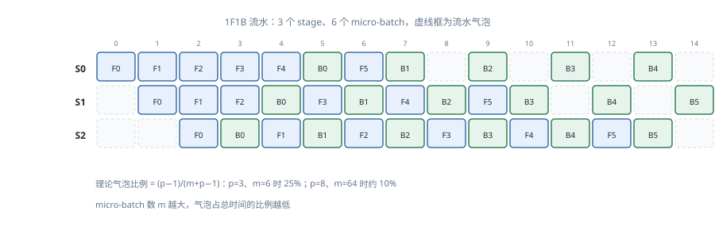

# Chapter 39. Distributed Training

70B 模型的一步训练，梯度是 140 GB。DDP 每步要把这 140 GB 同步一遍：NVLink 上 0.31 秒，跨节点 InfiniBand 上 5.6 秒——而一步计算本身只有几秒。纯数据并行在 70B 上根本不成立。

分布式训练要解决的是三个互相牵制的问题：显存放不下、梯度同步太贵、以及切分带来的通信。这一章按“从简单到复杂”的顺序，讲 DDP、ZeRO、FSDP、TP、PP、SP/CP 各自解决什么、付出什么，最后给出 70B 在千卡规模上的组合方案。

## 39.1 Distributed Data Parallel

数据并行（distributed data parallel，DDP）复制完整模型到每个 rank，每个 rank 处理不同的数据分片，反向结束后 all-reduce 梯度，再各自更新：

```text
rank 0: 模型副本 + batch 0 ──┐
rank 1: 模型副本 + batch 1 ──┼── all-reduce 梯度 ── 各自更新
rank 2: 模型副本 + batch 2 ──┤
rank 3: 模型副本 + batch 3 ──┘
```

它不减少任何显存，只扩展吞吐。对 7B 以下的模型，DDP 是最简单有效的方案；对 70B，单卡放不下参数，DDP 直接出局。

DDP 的工程细节在重叠。反向是逐层进行的，第 20 层的梯度算完时，第 19 层还在算；如果等所有梯度算完再同步，通信就完全暴露在关键路径上。实际实现把梯度按 bucket 分组，一个 bucket 满了立即发起 all-reduce，与后续层的反向并行。

bucket 越大，单次通信效率越高（摊薄延迟），但第一层要等更久；bucket 越小，重叠越好，但通信次数多。25 MB 左右是常见的折中。

## 39.2 Gradient Synchronization

梯度同步的通信量很直接：每个 rank 要发送自己那份梯度，最终所有 rank 拿到总和。

ring all-reduce 每 rank 搬运 `2(N-1)/N × S`，`S` 是梯度字节数。`N` 较大时约等于 `2S`。

70B BF16 训练：

```text
S = 140 GB
每 rank 通信量 ≈ 2 × 140 GB = 280 GB
NVLink 900 GB/s：0.31 s
IB 400 Gb/s（50 GB/s）：5.6 s
```

假设 8 卡各跑 8 条 8K 序列，一步 65,536 个 token，计算量 `65,536 × 420 GFLOP = 27.5 PFLOP`；按 3.16 PFLOPS 要 8.7 秒。跨节点同步 5.6 秒，占 64%——即使模型放得下，DDP 也不划算。

这也是为什么大规模训练必须做梯度压缩或分层同步：

- **分层 all-reduce**：节点内 NVLink 先聚合，节点间只传聚合结果，通信量降到 `2S × (节点数-1)/节点数`；
- **梯度压缩**：FP16/BF16 已经减半，再低就要处理精度损失；
- **异步更新**：允许梯度延迟，牺牲收敛性换吞吐，LLM 训练很少用；
- **拓扑感知**：把 DP 组放在同一交换机下，避免跨 spine。

## 39.3 ZeRO Stages

ZeRO 的思路是把 DDP 中每卡都完整保存的三样东西——优化器状态、梯度、参数——分片到 `N` 个 rank：

| 阶段 | 分片内容 | 7B 每卡显存（N=8） | 通信量（相对 DDP） |
| --- | --- | --- | --- |
| DDP | 无 | 112 GB + 激活 | 1× |
| ZeRO-1 | 优化器状态 | 38.5 GB + 激活 | 1× |
| ZeRO-2 | 优化器状态 + 梯度 | 26.25 GB + 激活 | 1× |
| ZeRO-3 | 优化器状态 + 梯度 + 参数 | 14 GB + 激活 | 1.5× |

ZeRO-1 和 ZeRO-2 的通信量和 DDP 相同：梯度还是要 all-reduce，只是结果做成了 reduce-scatter，每卡只留自己负责的那片。ZeRO-3 多了参数的 all-gather——前向每层要用完整参数，反向也要，所以通信量约为 DDP 的 1.5 倍。

```python
# ZeRO-1 的更新：只有 rank i 负责参数分片 i
optimizer.step()                      # 更新本地分片
all_gather(param_shards, params)      # 分片广播回所有 rank
```

ZeRO 的收益在显存，代价在通信和实现复杂度。7B、N=8 时，ZeRO-3 把 112 GB 压到 14 GB，单卡 80 GB 完全放得下，代价是每层两次 all-gather。

## 39.4 Fully Sharded Data Parallel

FSDP 是 ZeRO-3 的工程实现，思路相同，组织方式不同：它以“层”为单位管理分片，前向到某层时 all-gather 该层参数，用完立即释放；反向时再 all-gather 一次，算完梯度后 reduce-scatter。

```text
前向 layer i:  all-gather 参数 → 计算 → 释放完整参数（只留分片）
反向 layer i:  all-gather 参数 → 算梯度 → reduce-scatter 梯度 → 释放
```

它的显存曲线是“一层完整参数 + 其余层分片”，峰值取决于最大的一层。70B 的一层约 1.75 GB（140 GB / 80），远小于整模型，所以 FSDP 在显存上非常有效。

FSDP 的代价同样是通信。每层两次 all-gather（前向、反向）加一次 reduce-scatter，通信次数是 DDP 的几十倍。它靠预取掩盖延迟：计算第 `i` 层时，提前 all-gather 第 `i+1` 层。预取深度不够，通信就会暴露；预取太深，显存又涨回去。

FSDP 和 TP 的取舍很清晰：节点内用 TP（NVLink 快，通信量可接受），节点间用 FSDP（通信量小，适合慢链路）。

## 39.5 Tensor Parallel Training

TP 在训练中的通信是推理的两倍：前向每层 2 次 all-reduce，反向还要 2 次（列并行的输入梯度、行并行的权重梯度）。

70B、TP=8、`S=8192` 的一条序列：

```text
每层激活 128 MB，all-reduce 每 rank 224 MB
前向：2 × 80 × 224 MB = 35.8 GB
反向：约 2 倍，71.6 GB
合计约 107 GB
NVLink 900 GB/s：约 119 ms
```

这条序列的前向加反向计算约 `3 × 240 ms = 720 ms`，通信占 17%。这是 TP=8 在节点内的可接受范围；如果 TP 跨节点，119 ms 会变成 2 秒以上，完全不可行。

TP 训练还有一个额外开销：反向的 all-reduce 要和重计算、梯度累积交错，调度比推理复杂。实现上通常把 all-reduce 放在独立的通信流里，和相邻层的计算重叠一部分。

## 39.6 Pipeline Parallel Training

PP 把层分到不同 stage，训练时需要前向和反向交替：

```text
warmup:   F F F F
steady:   F B F B F B ...
cooldown: B B B B
```

1F1B 调度的气泡比例是 `(p-1)/(m+p-1)`。`p=8, m=64` 时是 7/71 ≈ 10%；`m` 不够大时气泡显著。

PP 训练的两个关键参数：

- **microbatch 数 `m`**：越大气泡越小，但每个 microbatch 变小，GEMM 效率下降；
- **stage 划分**：按计算量而不是层数均分，否则最慢的 stage 决定节奏。

PP 的通信量很小：stage 间只传 `B × S × h × 2` 的激活，8K、`h=8192` 时 128 MB，点对点传输，900 GB/s 下 0.14 ms。它的代价是气泡和激活显存——每个在途 microbatch 都要保留激活，1F1B 下同时驻留 `p` 个。



图 39-1　1F1B 调度：预热阶段各 stage 连续做前向，稳态阶段交替做最早 micro-batch 的反向和下一个前向，虚线框是气泡

## 39.7 Sequence and Context Parallel Training

SP 和 CP 都切序列维，但目的不同。

**SP（sequence parallelism）** 配合 TP 使用，把 LayerNorm、dropout 这些逐位置操作按序列切分，避免每个 rank 重复计算完整激活。它在 column parallel 后 all-gather、row parallel 前 reduce-scatter，通信量和 TP 同阶，收益是激活显存降低。

**CP（context parallelism）** 切 attention 的序列维，服务超长上下文。每个 rank 持有自己那段 Q，K/V 通过 ring 传递，用 online softmax 合并：

```text
rank 0 算 Q0 对 K0..K3，K/V 块沿环流动
每轮：接收邻居的 K/V 块 → 算 partial attention → 传给下一个
```

CP 的通信量是每层 `O(S·h)`，和 TP 同阶，但只在 attention 内发生。128K 上下文时，单卡 KV 放不下，CP 是少数可行的方案。

CP 的负载不均来自 causal mask：前面的 rank 看到的 key 少。常见做法是按“头尾配对”分配序列块，让每对 rank 的工作量接近。

## 39.8 Hybrid Parallel Training

千卡规模训练 70B，典型配置是：

```text
节点内 TP=8
节点间 PP=4
数据并行 DP=32
总卡数 8 × 4 × 32 = 1024
```

显存账：TP=8 使每卡参数 17.5 GB；PP=4 使每卡只放 20 层，参数 4.4 GB；ZeRO-1 再把优化器状态切 32 份，每卡约 26 GB。加上激活和重计算，单卡 80 GB 有余量。

通信账：全局 batch 取 400 万 token，一步的计算量是 `4e6 × 420 GFLOP = 1.68 EFLOP`，1024 张卡按 405 PFLOPS 有效算力计算，约 4.1 秒。

| 通信类型 | 组大小 | 每步数据量 | 时间（估算） |
| --- | --- | --- | --- |
| TP all-reduce | 8（NVLink） | 每卡约 51 GB | 57 ms |
| PP 点对点 | 4（跨节点） | 激活分片 | 可忽略 |
| DP 梯度同步 | 32（跨节点） | 280 GB 分片后 8.75 GB | 175 ms（IB） |

总通信约 230 ms，占 4.1 秒的 5.6%。如果全部暴露，MFU 上限就是 94%；实际重叠率在 70%–85%，暴露的 1%–2% 是 MFU 损失的主要来源之一。

放置顺序的经验：

1. TP 组放在同一节点，用 NVLink；
2. PP 组跨节点，通信量小；
3. DP 组跨节点，用分层 all-reduce；
4. EP 组按专家数跨节点，尽量让热门专家同节点。

## 39.9 Distributed Optimizers

优化器本身也在“分布式化”。

**ZeRO 的分片优化器**把 Adam 的状态和更新计算都切开。每个 rank 只更新自己负责的参数分片，更新时只需要该分片的梯度（reduce-scatter 得到）和状态。这把更新计算也分摊了，不只是显存。

**8-bit Adam** 用分块量化把 `m`、`v` 压到 1 字节，显存省 75%，精度损失在多数任务上可接受。它和 ZeRO 叠加时要注意：量化误差会在分片边界累积，需要 per-block 的缩放因子。

**Adafactor** 用行、列两个向量的外积近似二阶矩，把 `v` 的存储从 `O(n)` 降到 `O(√n)`。它在 T5 等模型上是标配，但对 LLM 的收敛影响仍有争议，大模型训练里不如 AdamW 常见。

**优化器状态的检查点**要一起分片保存，否则恢复时要么重新分片、要么加载失败。ZeRO-3 的 checkpoint 通常按分片存，元数据里记录全局布局。

分布式优化器的共同点是：状态越大，分片收益越高；但每一步的通信和同步也越多，最终受限于最慢的 rank。

## 本章小结

- DDP 复制模型、扩展吞吐，不解决显存；70B 的梯度同步在跨节点时要 5.6 秒，纯 DP 不可行。
- 梯度同步的通信量约为 `2S`，可用分层 all-reduce、拓扑感知和更大的 batch 摊薄。
- ZeRO-1/2/3 依次分片优化器状态、梯度、参数；7B 在 N=8 时每卡从 112 GB 降到 38.5/26.25/14 GB，ZeRO-3 的通信约为 DDP 的 1.5 倍。
- FSDP 是 ZeRO-3 的工程实现，按层 all-gather 和 reduce-scatter，靠预取掩盖通信，适合跨节点。
- TP 训练每层前向 2 次、反向 2 次 all-reduce；70B、8K、TP=8 一条序列约 107 GB，占计算时间的 17%。
- PP 训练的气泡是 `(p-1)/(m+p-1)`，靠 1F1B 和足够的 microbatch 压到 10% 左右；通信量小，适合跨节点。
- SP 切 norm 等逐位置操作，CP 切 attention 序列维；后者是超长上下文的主要手段。
- 70B 千卡的典型组合是 TP=8 × PP=4 × DP=32；每步通信约占 5.6%，重叠率决定 MFU 损失。
- 分布式优化器把状态和更新一起分片；8-bit Adam、Adafactor 用低精度或低秩换显存，但要注意收敛影响。

## 延伸阅读

- Li et al., [PyTorch Distributed: Experiences on Accelerating Data Parallel Training](https://arxiv.org/abs/2006.15704), VLDB 2020.
- Rajbhandari et al., [ZeRO: Memory Optimizations Toward Training Trillion Parameter Models](https://arxiv.org/abs/1910.02054), SC 2020.
- Zhao et al., [PyTorch FSDP: Experiences on Scaling Fully Sharded Data Parallel](https://arxiv.org/abs/2304.11277), VLDB 2023.
- Shoeybi et al., [Megatron-LM: Training Multi-Billion Parameter Language Models Using Model Parallelism](https://arxiv.org/abs/1909.08053), 2019.
- Narayanan et al., [Efficient Large-Scale Language Model Training on GPU Clusters Using Megatron-LM](https://arxiv.org/abs/2104.04473), SC 2021.
- Korthikanti et al., [Reducing Activation Recomputation in Large Transformer Models](https://arxiv.org/abs/2205.05198), MLSys 2023.
- Liu et al., [Ring Attention with Blockwise Transformers for Near-Infinite Context](https://arxiv.org/abs/2310.01889), 2023.
- Dettmers et al., [8-bit Optimizers via Block-wise Quantization](https://arxiv.org/abs/2110.02861), ICLR 2022.
- Shazeer and Stern, [Adafactor: Adaptive Learning Rates with Sublinear Memory Cost](https://arxiv.org/abs/1804.04235), ICML 2018.
