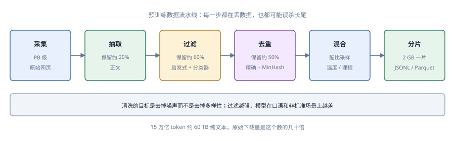

# Chapter 41. Data Engineering for LLMs

训练 15 万亿 token 的模型，原始语料要以 PB 计。这些数据不是现成的：网页里有导航栏和广告，代码里有重复的仓库，书籍里有扫描错误，评测集还可能混在训练集里。

数据工程决定模型能力的上限，但它的产出很难直接度量——换一套清洗规则，loss 曲线可能更好看，评测分数却下降。这一章讲数据的采集、清洗、去重、混合、合成和治理，重点是每一步的取舍，以及这些取舍如何传到最终的训练结果上。

## 41.1 Data Acquisition and Storage

预训练语料通常来自几类来源：

| 来源 | 规模 | 特点 | 主要问题 |
| --- | --- | --- | --- |
| 网页爬取 | 数千亿页面 | 覆盖广、更新快 | 噪声高、版权争议 |
| 代码仓库 | 数十亿文件 | 结构清晰、逻辑密度高 | 许可证、重复 |
| 书籍与论文 | 数百万本/篇 | 长文本、高质量 | 扫描错误、版权 |
| 百科与问答 | 数亿条目 | 事实性强 | 覆盖偏窄 |
| 合成数据 | 无上限 | 可控、可定向 | 多样性差、自噬风险 |

15 万亿 token 按每 token 约 4 字节估算，纯文本约 60 TB；考虑到原始网页的 HTML、编码、重复和清洗损耗，原始下载量通常是这个数的几十倍。

存储格式上，训练用的数据几乎都是 JSONL 或 Parquet。JSONL 便于流式处理和逐条检查；Parquet 列式压缩率高，适合大规模扫描。真正影响效率的是分片（shard）粒度：单个文件几 GB，既能并行读，又不会让某个 worker 拖尾。

采集阶段就要考虑许可与合规。不同来源的许可证差异很大：有的允许商用，有的仅限研究，有的完全禁止再分发。这些信息要随数据一起记录，否则后期无法追溯。



图 41-1　预训练数据流水线：每个阶段都在丢数据，阈值调高会连口语和非标准表达一起删掉

## 41.2 Data Cleaning and Filtering

清洗的目标是去掉“不像自然语言”的内容，同时保留多样性。

常见的启发式规则：

- **长度**：过滤过短（< 50 词）或过长（> 100K 字符）的文档；
- **符号比例**：标点、数字、大写字母占比异常的文档，往往是模板或乱码；
- **重复行**：文档内重复行超过一定比例，通常是导航栏或日志；
- **语言识别**：用 fastText 之类的分类器判断语种，只保留目标语言；
- **停用词**：英文文档里常见词比例过低，可能是关键词堆砌。

规则之后通常还有质量分类器：用一个小模型给文档打“像不像高质量文本”的分，按分位截断。分类器可以用人工标注训练，也可以用高质量语料（如维基、书籍）作为正样本。

```python
def keep(doc):
    if not (50 <= len(doc.text.split()) <= 100_000):
        return False
    if doc.punct_ratio > 0.3 or doc.digit_ratio > 0.3:
        return False
    if doc.dup_line_ratio > 0.3:
        return False
    if doc.lang != "zh" or doc.lang_score < 0.8:
        return False
    return doc.quality_score >= threshold
```

过滤强度和多样性是此消彼长的。阈值调高，留下的都是“教科书式”的干净文本，但会把口语、论坛、非标准表达一起删掉，模型在这些场景上反而变差。经验做法是保留多档质量分层，训练时按比例混合。

## 41.3 Deduplication

重复数据有两个危害：一是让模型在这部分内容上过拟合，二是增加记忆和逐字复现的风险。

去重分三个粒度：

| 粒度 | 方法 | 成本 | 效果 |
| --- | --- | --- | --- |
| 精确去重 | 文档哈希 | `O(N)` | 去掉完全相同的副本 |
| 近似去重 | MinHash + LSH | `O(N)` 近似 | 去掉改写、模板化内容 |
| 子串去重 | 后缀数组 | `O(N log N)` | 去掉长段落级重复 |

精确去重最简单：对规范化后的文本取哈希，重复的丢掉。它只能去掉逐字节相同的副本，实际语料里更多是“改了标题、换了模板”的近似重复。

近似去重的主流是 MinHash：把文档切成 n-gram 集合，用多个哈希函数取最小值的签名，签名相似度近似 Jaccard 相似度。再用 LSH 分桶，只在桶内比较，避免 `O(N²)` 的全量比对。阈值通常取 0.8 左右，低于它就可能误删不同文档。

子串去重针对“同一段内容被复制到很多文档里”的情况，比如许可证声明、模板段落。后缀数组能高效找出所有长公共子串，但内存开销大，通常只在清洗后期对高价值语料做。

去重的收益可以量化：去掉 30%–50% 的重复后，同样 token 预算下模型见到的独特内容更多，验证集 loss 通常更低，记忆测试的逐字复现率明显下降。

## 41.4 Data Sampling and Mixing

不同来源的数据要按比例混合。比例决定了模型的能力结构：代码比例高，推理和结构化输出更好，但自然语言流畅度可能下降；中文比例高，中文能力提升，英文可能退化。

混合策略有三种：

- **固定权重**：按人工设定的比例采样，简单可控；
- **温度采样**：按 `p_i ∝ n_i^α` 采样，`α > 1` 偏向大数据源，`α < 1` 提升小数据源的权重；
- **课程学习**：训练前期用简单/通用数据，后期加入高质量/领域数据。

比例不是拍脑袋定的。可行的方法是做小规模消融：用 1% 的算力训练多个混合比例，在目标评测集上比较，再放大到全量。这个方法的成本不低，但比训练完才发现比例错了便宜得多。

另一个维度是重复轮次（epoch）。高质量数据（如书籍、论文）重复 2–4 轮通常有益；网页数据重复多轮会加速过拟合。重复带来的收益随轮次递减，通常在第 4 轮之后消失。

## 41.5 Synthetic Data Generation

合成数据用强模型生成训练数据，再用来训练弱模型，本质是蒸馏。

常见形式：

- **self-instruct**：让模型根据种子任务生成新的指令和回答；
- **拒绝采样**：生成多个候选，用验证器或强模型打分，只保留通过的；
- **教科书式生成**：围绕知识点生成解释、例题和推导（Phi 系列的做法）；
- **轨迹合成**：为 agent 任务生成完整的工具调用轨迹。

合成数据的优势是可控：可以定向补齐能力短板，也可以生成难以人工标注的推理链。风险是分布偏移和“自噬”：模型生成的数据带有自己的偏差，反复训练会放大这些偏差，多样性逐渐塌缩。

控制风险的手段：

- 保留足够比例的真实数据，合成数据通常不超过 30%；
- 用验证器过滤（数学题验算、代码执行、事实核查），而不是只靠模型自评；
- 定期在留出的人类评测集上检查，防止合成数据把评测也“污染”了。

## 41.6 Data Versioning and Governance

数据要能追溯：某个模型版本用了哪些数据、哪个版本、什么清洗规则。

实践上需要：

- **内容哈希**：每个数据集分片记录哈希，训练配置里固定哈希而不是路径；
- **血缘**：记录从原始抓取到最终分片的每一步处理和参数；
- **许可与归属**：每个来源的许可证、抓取时间、使用限制；
- **PII 处理**：邮箱、电话、身份证号等要检测并脱敏，且要能响应删除请求。

删除请求是最难满足的：模型已经训练完，无法“删掉”某个样本的影响。可行的做法是从后续版本的数据中移除，并记录影响范围；对强合规场景，需要在训练前就做好过滤。

## 41.7 Dataset Contamination

评测集泄漏进训练集，会让评测分数虚高，且很难发现。

检测方法是在训练数据里搜索评测集的 n-gram。常用 13-gram 或 50 字符的重叠检测：

```python
def is_contaminated(doc, eval_ngrams, n=13):
    tokens = tokenize(doc)
    grams = {tuple(tokens[i:i+n]) for i in range(len(tokens) - n + 1)}
    return len(grams & eval_ngrams) > 0
```

完全匹配只能抓到逐字复制的样本。改写过、翻译过、换格式的泄漏抓不到。更强的做法是用嵌入相似度检索，但成本高，通常只对高风险的评测集做。

去污染本身也有代价：删掉含评测 n-gram 的文档，可能连带删掉大量正常内容（比如评测题来自公开教材，教材的其他部分也被删）。更精细的做法是只删除重叠的片段，或者对训练样本降权。

污染的影响不只是分数虚高。如果模型在训练中见过答案，评测就无法反映真实的泛化能力，基于评测做的模型选择、数据配比、超参搜索都会失真。对发布模型的团队，污染检测应当是发布流程的一部分。

## 本章小结

- 预训练语料来自网页、代码、书籍、百科和合成数据；15 万亿 token 约 60 TB 纯文本，原始下载量高一个数量级以上。
- 清洗用长度、符号比例、重复行、语言识别和 quality classifier 过滤；过滤越强，多样性损失越大，实践中保留多档质量分层。
- 去重分精确、近似、子串三级；MinHash + LSH 是近似去重的主流，阈值 0.8 左右；去重能降低记忆和逐字复现。
- 数据混合比例决定能力结构，应通过小规模消融确定；高质量数据可重复 2–4 轮，收益随轮次递减。
- 合成数据可控但有自噬风险，通常不超过 30%，并用验证器而非模型自评来过滤。
- 数据治理要记录哈希、血缘、许可和 PII 处理；删除请求无法追溯已训练的模型，只能从后续版本移除。
- 评测污染用 n-gram 重叠检测，只能抓逐字泄漏；污染会让模型选择和超参搜索整体失真，应纳入发布流程。

## 延伸阅读

- Penedo et al., [The FineWeb Datasets: Decanting the Web for the Finest Text Data at Scale](https://arxiv.org/abs/2406.17557), 2024.
- Gao et al., [The Pile: An 800GB Dataset of Diverse Text for Language Modeling](https://arxiv.org/abs/2101.00027), 2020.
- Lee et al., [Deduplicating Training Data Makes Language Models Better](https://arxiv.org/abs/2107.06499), ACL 2022.
- Broder, [On the Resemblance and Containment of Documents](https://ieeexplore.ieee.org/document/666900), 1997.
- Gunasekar et al., [Textbooks Are All You Need](https://arxiv.org/abs/2306.11644), 2023.
- Wang et al., [Self-Instruct: Aligning Language Models with Self-Generated Instructions](https://arxiv.org/abs/2212.10560), ACL 2023.
- Wei et al., [Language Models are Few-Shot Learners](https://arxiv.org/abs/2005.14165), 2020.
- Singh et al., [Programming Language Data Contamination in LLMs](https://arxiv.org/abs/2410.03492), 2024.
