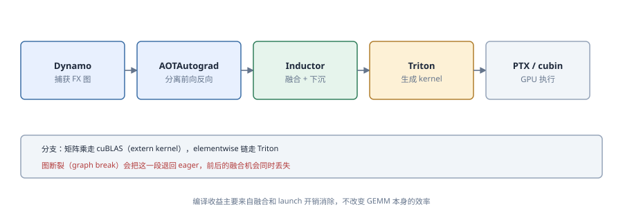

# Chapter 45. Compiler and Graph Optimization

写模型的人只描述“算什么”，不描述“怎么算”。同样的一个 Transformer 层，手写 CUDA 可以做到 40% 的算力利用率，逐算子调用 PyTorch 可能只有 15%——差的不是 kernel 本身，而是算子之间的衔接：中间的张量要写回显存再读出来，每个算子单独启动一次。

编译器的工作就是消除这些衔接成本：把图里的算子融合、把循环切到合适的粒度、为每种形状挑选或生成 kernel。这一章讲计算图的表示、变换、融合、下沉和代码生成，重点是编译器能做什么、不能做什么，以及它在 decode 这种“形状小、启动开销占比高”的场景里为什么格外重要。

## 45.1 Computational Graph Representation

计算图把模型描述成算子（operator）和数据依赖构成的有向无环图。一个 Transformer 层在 `torch.fx` 里大致是：

```python
def forward(self, x, mask):
    h = self.norm1(x)
    q, k, v = self.qkv(h).split(...)
    attn = torch.nn.functional.scaled_dot_product_attention(q, k, v, attn_mask=mask)
    x = x + self.o_proj(attn)
    h = self.norm2(x)
    return x + self.down_proj(self.act(self.gate(h)) * self.up(h))
```

`torch.fx` 把它捕获成 `GraphModule`：节点是 aten 算子（`aten.layer_norm`、`aten.mm`、`aten.silu`），边是张量依赖。这个层次的图保留了几乎所有语义信息，但离硬件还很远。

图有三类表示，各有取舍：

| 表示 | 粒度 | 优点 | 缺点 |
| --- | --- | --- | --- |
| 动态图（eager） | 每次执行重建 | 灵活，调试友好 | 无法全局优化 |
| 静态图（FX/HLO） | 整图捕获 | 可全局变换 | 控制流、动态形状受限 |
| 多级 IR（MLIR） | 多层方言 | 逐层下降、可复用 pass | 实现复杂 |

LLM 推理的图有一个特殊之处：**decode 阶段每步的图完全一样**，只是输入不同。这本来最适合静态图，但输入形状（batch、序列长度）一直在变，静态图要为每个形状编译一次，代价是分钟级。所以现代方案大多走“捕获 + 动态形状 + 按形状特化”的组合。

## 45.2 Graph Transformation

图变换分两类：语义保持的化简，和为性能而做的重写。

**化简类**：

- **常量折叠**：`rope` 的频率表、位置编码的 sin/cos 在编译期算好；
- **公共子表达式消除**：两个分支用同一个归一化结果，只算一次；
- **死代码消除**：训练时是 `logits`，推理只要最后一个 token，前面的 `lm_head` 可以裁掉——这是投机解码里 tree attention 的 `lm_head` 只算叶节点的基础；
- **代数重写**：`x * 1.0 → x`，`concat` 后接 `split` 抵消。

**性能类**：

- **布局变换插入**：把 `NCHW` 转成 `NHWC` 以匹配 Tensor Core 的偏好；
- **重排结合律**：把 `(a + b) + c` 改成 `a + (b + c)`，让相邻的骨干操作能融合；
- **量化感知重写**：`mm → quantize → mm` 合并成 `int8_gemm`；
- **通信重排**：TP 的 all-reduce 提前或推迟，和相邻计算重叠。

变换的顺序很关键。常量折叠要在布局变换前做，否则会先把常量转成低效布局；融合要在下沉前做，否则 kernel 已经生成，改不动了。这就是为什么编译器要用多级 IR：每一级的 pass 只关心本级的抽象。

## 45.3 Operator Fusion

融合是编译器最大的收益来源，也是最能体现“系统知识”的部分。

**纵向融合**（producer-consumer）：前一个算子的输出只被后一个用，就合并成一个 kernel。典型是 `residual add + RMSNorm + quantize` 三合一：本来要写三次显存、读三次，融合后只读写一次。

**横向融合**（batch 维度）：多个形状相同、互不依赖的算子合并成一个大的。典型是 MoE 里多个专家的同形 GEMM 拼成一个 group GEMM。

**Epilogue 融合**：把 `bias add`、`activation`、`residual add` 塞进 GEMM 的输出阶段，省掉一次全量读写。

量化一下纵向融合的收益。prefill、batch 32、序列 4,096 时，一层里的 hidden 张量是 `131,072 × 8,192 × 2 B ≈ 2.1 GB`。任何一次多余的 elementwise 遍都要读 2.1 GB、写 2.1 GB，在 3.35 TB/s 下约 1.3 ms。一个 80 层的模型，每层省下一遍就是 160 遍，约 200 ms——相对于这个 batch 约 5.8 秒的 prefill 计算，是 3% 左右。看起来不多，但 elementwise 算子往往是成串出现的，实际能省 3–5 遍。

融合不是无条件的。判断标准是：**融合后的 kernel 是否仍然是访存受限且寄存器够用**。把两个大的 reduction 融合到一起，寄存器溢出会把性能打回原形；把 attention 外的算子和 attention 融合，则要重写整个 attention kernel——这正是 FlashAttention 手写而不是靠编译器生成的原因。

## 45.4 Graph Lowering

下沉（lowering）是把高层算子逐级翻译成接近硬件的表示：

```text
aten.mm  →  linalg.matmul  →  tiled + vectorized  →  Triton/PTX
```

每一级都要做决策：

- **aten → linalg**：选择算法，比如 GEMM 用哪个 tile 策略；
- **linalg → tiled**：确定 tile 大小、线程映射、shared memory 用量；
- **tiled → LLVM/PTX**：向量化、展开、寄存器分配。

下沉过程中最重要的信息是**形状和 dtype**。`mm` 在 `M=8192, N=8192, K=8192` 时是计算受限，适合大 tile；在 decode 的 `M=1` 时是访存受限，几乎退化成 GEMV，适合完全不同的 kernel 和并行方式。编译器如果不知道 `M` 的范围，就只能生成一个折中的通用实现，而这往往对两头都不好。

另一个决策是**融合边界**。下沉到 linalg 后，相邻的 elementwise 算子天然可以合成一个 `linalg.generic`；但一旦某一步被映射成调用外部库（cuBLAS、cuDNN），融合边界就被切断了。这就是 Inductor 里 `mm` 默认走 extern kernel（cuBLAS）而 elementwise 走 Triton 的原因：前者成熟，后者灵活，融合只能在 Triton 那一侧做。

## 45.5 Shape Specialization

LLM 推理的形状变化极大：prefill 的 `S` 从几十到几十万，decode 的 batch 从 1 到几千，序列长度每步加一。如果为每个形状编译一次，编译时间会吞掉所有收益。

方案是**符号形状 + 特化守卫**：

```python
# 动态维度用符号表示
graph: (s0, s1) -> mm(x: [s0, 4096], w: [4096, 4096])
# 生成代码时假设 s0 % 16 == 0
guards: [s0 % 16 == 0, s0 >= 16]
```

只要实际形状满足守卫，就复用已编译的 kernel；不满足就重新编译。实践中会把 batch 按 2 的幂向上取整（`batch → next_pow2`），把序列长度按 128 对齐，把形状空间压缩到几十个桶，编译缓存一次之后基本不再触发重编译。

**动态形状的代价**在 kernel 内部。`s0` 是符号时，tile 循环的边界不能常量折叠，要走带谓词的循环，寄存器压力更大，编译器也不敢做激进的展开。经验数据是：同样一个 GEMM，完全特化比动态形状快 5%–15%；对 elementwise 融合链，差距可达 20%。

PyTorch 2 的 `torch.compile` 默认在 `dynamic=False` 时按具体形状编译，遇到新形状就重编译；`dynamic=True` 时用符号形状，牺牲一点性能换取编译次数。LLM 服务里通常手工把 batch 分桶，让两种模式的差别降到可接受的范围。

还有一个隐蔽的问题：**重编译抖动**。线上流量变化会让 batch 在桶之间来回跳，如果分桶边界没设计好，可能每隔几秒就触发一次编译，表现为周期性的延迟尖峰。这类问题在压测里很难复现，必须靠线上监控编译缓存命中率才能发现。

## 45.6 Kernel Selection

对每个算子，编译器要在若干实现里选一个：

- **库调用**：cuBLAS、cuDNN、FlashAttention 的预编译 kernel；
- **模板实例化**：CUTLASS 的模板按形状实例化；
- **自动生成**：Triton 即时生成；
- **手写 kernel**：针对特定形状的极致优化。

选择的依据分两层。先按启发式规则粗筛（形状、dtype、是否需要 epilogue），再在少量候选上做 autotune：跑 5–20 个配置，取最快的。autotune 的代价是首次运行慢几百毫秒到几秒，必须缓存结果。

decode 场景暴露了库调用的局限。`M=1` 的 GEMM 本质是 GEMV，cuBLAS 在这么小的 `M` 上会退回到不理想的实现，而专门的 skinny GEMM kernel 或 fused GEMV 能快 2 倍以上。所以 vLLM、TensorRT-LLM 都会为 decode 单独实现或选择 kernel，而不是交给默认的库启发式。

选择还要考虑**端到端**，而不是单算子。一个在单测里快 10% 的 GEMM，如果 epilogue 不能融合、多了一次显存往返，端到端可能更慢。这就要求编译器在做出选择时能看到上下文——这正是融合和选择必须一起做的原因。

## 45.7 Code Generation

代码生成把 IR 翻译成可执行的 kernel。主流有两条路线：

**DSL 生成**：用 Triton 这样的嵌入式 DSL 写 kernel，编译器负责切 tile、分配 shared memory、插入 `cp.async`、做软件流水。Triton 的抽象层次适合 elementwise 融合和中等复杂度的 reduction，但对 attention 这种需要精细控制 shared memory 布局的 kernel，生成的代码仍不如手写。

**模板生成**：CUTLASS 用 C++ 模板把 tile 大小、warp 分工、pipeline 深度参数化，实例化出针对特定形状的 kernel。生成的是高度优化但缺乏灵活性的代码。

代码生成的质量取决于几个决策：

- **tile 大小**：受 shared memory 和寄存器限制，`128×128×64` 的 BF16 tile 需要 `(128×64 + 64×128) × 2 B = 32 KB` shared memory，三缓冲就是 96 KB，接近 SM 的上限；
- **pipeline 深度**：深度越深，访存和计算重叠越好，但 shared memory 越紧张；
- **warp specialization**：把生产者（load）和消费者（mma）分到不同 warp，需要 Hopper 的 TMA 和 warpgroup 支持。

这些决策不能靠一个通用策略覆盖所有形状。所以现代编译器大多是“生成 + 搜索”：生成一组参数化候选，在实际硬件上测，缓存最优配置。

## 45.8 PyTorch Compiler and Inductor

`torch.compile` 是 PyTorch 2 的核心，流程是：

```text
Dynamo 捕获 FX 图
  → AOTAutograd 分离前向反向
  → Inductor 做融合与下沉
  → Triton 代码生成 或 extern kernel 调用
```



图 45-1　`torch.compile` 的编译流水线：矩阵乘交给 cuBLAS，elementwise 链交给 Triton；图断裂会把整段退回 eager

**Dynamo** 负责从 eager 代码里捕获图。它在 Python 字节码层面拦截，遇到无法追踪的控制流就“图断裂”（graph break），把这一段退回 eager 执行。图断裂是性能杀手：每断一次，前后的融合机会就少一批。

**Inductor** 的核心是调度器。它把 FX 图切成 `SchedulerNode`，按读写依赖决定哪些能融合成一个 Triton kernel，然后生成：

```python
@triton.jit
def fused_kernel(x_ptr, w_ptr, out_ptr, n, BLOCK: tl.constexpr):
    pid = tl.program_id(0)
    offs = pid * BLOCK + tl.arange(0, BLOCK)
    mask = offs < n
    x = tl.load(x_ptr + offs, mask=mask)
    w = tl.load(w_ptr + offs, mask=mask)
    y = x * tl.rsqrt(...) * w          # 融合的 norm + scale
    tl.store(out_ptr + offs, y, mask=mask)
```

对矩阵乘，Inductor 默认调用 cuBLAS（`extern_kernel`），只有在模板配置更优时才用 Triton 模板。所以 `torch.compile` 对 LLM 的收益主要来自三块：elementwise 融合、减少 launch 开销、以及消除 Python 解释器的逐算子调度。

收益的量级：对 LLM 推理，`torch.compile` 通常能带来 10%–30% 的端到端提升，prefill 阶段明显，decode 阶段取决于能否消除 launch 开销。它不会改变 GEMM 本身的效率——那需要换库或换 kernel。

## 45.9 XLA and MLIR

XLA（accelerated linear algebra）是 JAX 和 TensorFlow 的编译器，走的是“整图编译”路线：

```text
HLO（高层算子图）
  → 布局分配
  → 融合（把 elementwise 链和 reduction 合成 fusion 指令）
  → 内存空间分配
  → 后端代码生成（LLVM → PTX）
```

XLA 的特点是**全程序视角**：整个前向是一个 HLO 模块，布局、融合和内存分配可以全局决策。这让它在训练场景（形状固定、图很大）里表现很好，TPU 上尤其如此。代价是编译时间长，动态形状支持弱，控制流要显式建模。

MLIR 是更底层的框架，提供多级方言：

| 方言 | 抽象层次 | 用途 |
| --- | --- | --- |
| `stablehlo` | 高层张量算子 | 前端互操作 |
| `linalg` | 结构化循环 | 通用优化和下沉 |
| `tensor` / `memref` | 值语义 / 缓冲语义 | 内存规划 |
| `scf` / `affine` | 控制流和循环变换 | 循环优化 |
| `gpu` / `nvvm` | GPU 执行模型 | 硬件映射 |

MLIR 的价值在于**可组合**：每一级方言有自己的 pass，新的硬件后端只需要实现最后一两级。IREE、Triton 的部分实现、以及各家推理引擎都建立在 MLIR 之上。

## 45.10 Triton Compiler Architecture

Triton 的编译链是：

```text
Python AST
  → TTIR（张量级 IR，块语义）
  → TTGIR（加入 layout、shared memory、warp 分配）
  → LLIR（LLVM IR）
  → PTX / cubin
```

关键在 TTGIR 这一级。Triton 用 `blocked`、`shared`、`mma` 等布局描述张量在寄存器和 shared memory 里的分布，编译器负责在布局之间插入转换（`convert_layout`），并决定何时把数据放进 shared memory 做 `mma` 的输入。

几个重要的 pass：

- **合并与规范化**：把相邻的 elementwise 操作合并，消除恒等变换；
- **循环流水**：把 `tl.load` 和计算重叠，对应硬件上的 `cp.async` 加多缓冲；
- **自动调优**：`BLOCK_M/N/K`、`num_warps`、`num_stages` 的组合由 autotune 搜索。

Triton 的抽象让非 GPU 专家也能写出接近手写的 kernel，这是它在推理引擎里被广泛采用的原因。它的边界是**无法表达一些细节控制**：不暴露具体的寄存器分配、不支持复杂的跨 warp 同步、shared memory 布局也只能间接影响。FlashAttention 的早期版本用 Triton 写，后来为了压榨 Hopper 的 TMA 和 warpgroup，核心路径改回了 CUDA。

对系统工程师来说，理解 Triton 的编译链比会写 Triton kernel 更重要：看到性能不达预期时，要能判断问题出在布局转换、流水不足，还是 tile 配置不对，而不是盲目调 `num_stages`。

## 本章小结

- 计算图有三类表示：动态图灵活但无法全局优化，静态图可优化但受动态形状限制，多级 IR 兼顾两者但实现复杂。
- 图变换要在正确的阶段做：常量折叠先于布局变换，融合先于下沉；顺序错了，收益会被抹掉。
- 融合是最大收益来源：纵向融合消除中间张量的显存往返，横向融合合并同形算子，epilogue 融合省掉一次全量读写；融合的边界受寄存器和 shared memory 限制。
- 下沉时形状和 dtype 是核心信息；`M=1` 的 decode GEMM 和 `M=8192` 的 prefill GEMM 需要完全不同的实现。
- 动态形状靠符号形状和特化守卫，batch 分桶把形状空间压到几十个；重编译抖动会表现为周期性延迟尖峰，要靠缓存命中率监控。
- `torch.compile` 的收益主要来自 elementwise 融合和 launch 开销消除，LLM 推理端到端提升 10%–30%，不改变 GEMM 效率。
- XLA 走整图编译，形状固定时最优；MLIR 提供可组合的多级方言，是多数新后端的基础。
- Triton 的编译链是 TTIR → TTGIR → LLIR → PTX，核心在布局转换和流水；它适合中等复杂度 kernel，attention 这类仍需手写。

## 延伸阅读

- Chen et al., [TVM: An Automated End-to-End Optimizing Compiler for Deep Learning](https://www.usenix.org/conference/osdi18/presentation/chen), OSDI 2018.
- Tillet et al., [Triton: An Intermediate Language and Compiler for Tiled Neural Network Computations](https://www.eecs.harvard.edu/~htk/publication/2019-mapl-tillet-kung-cox.pdf), MAPL 2019.
- Sabne, [XLA: Compiling Machine Learning for Peak Performance](https://research.google/pubs/xla-compiling-machine-learning-for-peak-performance/), 2020.
- Lattner et al., [MLIR: Scaling Compiler Infrastructure for Domain Specific Computation](https://arxiv.org/abs/2002.11054), CGO 2021.
- Ansel et al., [PyTorch 2: Faster Machine Learning Through Dynamic Python Bytecode Transformation and Graph Compilation](https://pytorch.org/assets/pytorch2-2.pdf), ASPLOS 2024.
- Dao, [FlashAttention-2: Faster Attention with Better Parallelism and Work Partitioning](https://arxiv.org/abs/2307.08691), 2023.
- NVIDIA, [CUTLASS: CUDA Templates for Linear Algebra Subroutines](https://github.com/NVIDIA/cutlass).
