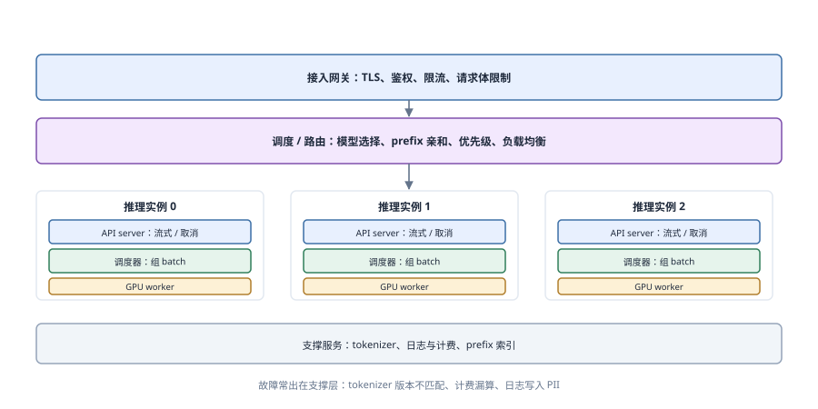

# Chapter 47. Production LLM Serving

> Part IX — Compiler, Runtime and Production Serving

把一个能跑通 demo 的推理引擎变成线上服务，中间隔着的不是性能问题，而是工程问题：请求超时了怎么取消，模型加载要两分钟时怎么扩容，一个用户的长文档会不会把别人的延迟拖垮，凌晨三点的延迟尖峰是谁造成的。

这一章讲服务层的设计：接入、路由、扩缩容、多租户、SLO 和成本。这些内容看起来离 kernel 很远，但线上 GPU 利用率能不能到 60%，一半取决于调度层怎么把请求组织起来。

## 47.1 Serving Architecture

一个生产级 LLM 服务通常分四层：

```text
接入网关        TLS、鉴权、配额、请求改写
调度/路由层     模型选择、优先级、负载均衡
推理集群        每个实例：API server + 调度器 + GPU worker
支撑服务        tokenizer、日志、计费、特征与缓存
```



图 47-1　生产级 LLM 服务的四层结构：接入网关不感知模型，调度层决定去向，实例内部再分 API server、调度器和 GPU worker

**接入网关**处理通用问题：证书、限流、鉴权、请求体大小限制。它不感知模型，只做转发和准入。

**调度/路由层**决定请求去哪个模型、哪个实例。它需要知道每个实例的负载、prefix cache 的分布、以及请求的优先级。

**推理实例**内部又分三部分：API server 负责 HTTP 和流式输出，调度器组 batch，GPU worker 执行。这三部分经常在同进程的不同线程，也可能拆成独立进程——拆开的好处是 CPU 侧的 tokenize 和调度不阻塞执行，坏处是多一次进程间通信。

**支撑服务**看起来边缘，但线上事故经常出在这里：tokenizer 版本和模型不匹配、计费漏算、日志把 PII 写进了磁盘。

一个架构选择是**是否做 PD 分离**（prefill 与 decode 分开部署）。prefill 是计算受限、decode 是访存受限，两者的最优 batch、显存配比和并行方式都不同。分离后可以各自配比，代价是 KV Cache 要在节点间传输——8K 上下文的 52 ms 传输，在 TPOT 10 ms 的 SLO 下几乎不可接受，所以分离通常只用于长 prompt、高吞吐的场景，且需要 RDMA 和精细的重叠。

## 47.2 API and Request Management

API 层面最重要的设计是**流式输出**：用 SSE 或 WebSocket 把 token 逐个推给客户端。它把用户感知的首字延迟从“生成完”变成“第一个 token”，也让取消请求成为可能。

请求的生命周期要显式建模：

| 阶段 | 主要工作 | 失败处理 |
| --- | --- | --- |
| 准入 | 鉴权、配额、长度校验 | 立即返回 4xx |
| 排队 | 优先级排序、超时计时 | 超时返回 429/503 |
| prefill | 计算 prompt 的 KV | 抢占、重算 |
| decode | 逐 token 生成 | 抢占、重算 |
| 结束 | flush、计费、日志 | 补记 |

生命周期的状态机落到代码上，每个 decode 步要做两件事：

```python
def tick(engine, queue, now):
    """每个 decode 步调用一次：先回收，再准入。顺序不能反。"""
    # 1. 回收：取消的请求必须立刻归还 KV 块，不能等它生成完
    for req in list(engine.running):
        if req.cancelled or req.generated >= req.max_tokens:
            engine.kv.release(req)
            engine.running.remove(req)

    # 2. 准入：按优先级出队，已经超过截止时间的直接拒绝，不要让它进 batch
    while engine.has_free_slot() and len(queue) > 0:
        req = queue.pop()
        if req.deadline < now:
            engine.metrics.reject(req, reason="timeout")
            continue
        engine.kv.allocate(req)
        engine.running.append(req)
```

几个容易做错的点：

- **取消要真的停**：客户端断开后，调度器要立刻回收 KV 块，否则一批已取消的请求会继续占用显存直到生成完；
- **max_tokens 是硬约束**：不设上限的请求可能生成几万 token，占满一个 batch 槽位；服务端必须有默认上限；
- **超时按阶段算**：TTFT 超时和总时长超时是两回事，长文档的 TTFT 可能是 5 秒，而总时长要 60 秒；
- **背压**：队列满时要快速拒绝，而不是无限排队。排队时间的方差远大于均值，排到 30 秒的请求对用户体验的伤害比直接失败更大。

计费口径也要在 API 层定清楚：输入 token、输出 token、缓存命中的 token 是否打折。口径不一致会导致后续成本核算全部失真。

## 47.3 Model Routing and Cascading

很少有服务只跑一个模型。典型配置是：

- 小模型（7B–8B）处理简单请求，延迟低、成本低；
- 大模型（70B 以上）处理复杂请求；
- 专用模型（代码、嵌入、重排）处理特定任务。

**路由**决定请求去哪个模型。可以基于：

- **显式标注**：客户端指定模型名，最简单；
- **分类器**：用一个小模型判断请求难度，准确率 85%–90%；
- **级联**（cascading）：小模型先答，置信度低时升级到大模型。

级联的成本模型值得算。假设 70% 的请求小模型能答好，小模型单 token 成本是大模型的 1/10：

$$
C_{\text{cascade}} = 0.7 \times 0.1C + 0.3 \times (0.1C + C) = 0.4C
$$

比全部走大模型省 60%，代价是 30% 的请求多了一次小模型的延迟（假设 200 ms）。如果 SLO 对 P99 要求严格，这 200 ms 可能吃掉大部分预算。

级联的判定标准是难点。“置信度低就升级”在实践中很难校准——模型的 logprob 并不总是和正确性相关。更可靠的做法是用可验证信号（格式检查、事实检索命中、代码测试）来判定，而不是靠模型自评。

## 47.4 Autoscaling

LLM 服务的扩缩容和 Web 服务完全不同：**冷启动要几分钟**。

一个 70B 实例的启动流程：

| 阶段 | 耗时 | 说明 |
| --- | --- | --- |
| 调度与容器拉起 | 10–30 s | 镜像拉取、GPU 分配 |
| 加载权重 | 40–60 s | 140 GB，NVMe 约 3 GB/s |
| 初始化 CUDA 与图捕获 | 20–40 s | 含编译、autotune |
| 预热 | 20–30 s | 跑几条请求，填满编译缓存 |
| 总计 | 1.5–2.5 min | 冷启动 |

这意味着扩容信号必须**提前**。等队列积压了再扩容，两分钟后流量高峰已经过去，新实例白开。常用做法：

- **预测式扩容**：按历史流量的日周期提前扩；
- **保留 warm pool**：常备 1–2 个已加载但未接流量的实例，扩容时直接挂上；
- **按队列深度和 TTFT 扩**：比按 QPS 更准确，因为 LLM 的容量取决于 token 数而不是请求数。

缩容要更保守。刚缩掉的实例如果马上又要扩回来，就是抖动。实践中的做法是设置冷却窗口（10–15 分钟），并保证最小副本数不低于峰值的一半。

还有一个和 KV Cache 相关的细节：**缩容会丢失 prefix cache**。一个实例上缓存了几百个系统提示词的 KV，缩容后新实例要重新计算。如果系统提示词很长（比如 4K token 的 agent 指令），重建缓存的开销会体现在扩容后的前几分钟里。

## 47.5 Load Balancing

LLM 的负载均衡不是简单的轮询。请求的代价差异巨大：一个 200 token 的问答和一个 32K 的文档摘要，计算量差 100 倍以上。

**按 token 数加权**比按请求数均衡更有意义。

同时要考虑：

- **请求长度分布**：长请求和短请求混在同一实例上，长请求会让短请求排队等 decode 槽位；
- **prefix 亲和**：同一系统提示词的请求路由到有缓存的实例，能省掉 prefill；
- **实例的 KV 水位**：显存快满的实例应该少接请求，否则会触发抢占。

**prefix 感知路由**的收益很直接。假设 200 个请求共享一段 2,000 token 的系统提示词，命中缓存能省掉每个请求 2,000 token 的 prefill，按 8K 上下文 240 ms 的比例，约 60 ms/请求，合计 12 秒的 GPU 时间。路由层需要维护一份“哪个实例有哪些 prefix”的索引，通常用一致性哈希加异步同步，代价是索引可能滞后几秒。

**长请求的隔离**是另一个常用手段：为长上下文请求单独一组实例，或者限制单实例上长请求的比例。否则一个用户上传的 128K 文档会占用大量 KV 块，把其他用户的 TPOT 从 12 ms 推到 30 ms。

## 47.6 Multi-tenant Serving

多租户的核心问题是**公平性**：一个租户的突发流量不能拖垮其他租户。

手段分三个层次：

| 层次 | 手段 | 效果 |
| --- | --- | --- |
| 隔离 | 独立实例、独立 GPU | 完全隔离，成本最高 |
| 配额 | 每租户 QPS/token 上限 | 防止单租户占满，但突发受限 |
| 调度 | 加权公平队列、优先级 | 灵活，但需要精细实现 |

**加权公平队列**（weighted fair queueing）在 LLM 场景里的实现要点是：公平性要按**资源消耗**算，而不是按请求数。一个租户发 10 个 32K 请求，和另一个租户发 10 个 200 token 请求，占用的 GPU 时间差 100 倍。按请求数分配槽位，前者会被严重低估。

具体做法是给每个请求估算代价（prefill token 数加预期输出 token 数），按租户累计已消耗的“虚拟时间”，调度时优先服务虚拟时间落后的租户。这就是 WFQ 的虚拟时钟算法。

**noisy neighbor** 的另一种表现是 prefix cache 污染：租户 A 的超长提示词占满了缓存，租户 B 的命中率从 70% 掉到 20%。缓解方式是给每个租户的缓存配额设上限，或者按租户分缓存分区。

**优先级**在多租户里不可避免：付费用户的请求要优先于免费用户，实时对话要优先于批处理。实现上通常是多级队列加抢占——低优先级请求在显存紧张时被换出（KV 暂存到 CPU），资源释放后再换入重算。

## 47.7 SLA and SLO

SLO 是服务承诺的可度量形式。LLM 服务通常关注四个指标：

| 指标 | 定义 | 典型目标 |
| --- | --- | --- |
| TTFT P99 | 首 token 延迟 | < 1 s（短 prompt） |
| TPOT P99 | 每输出 token 时间 | < 30 ms |
| 可用性 | 成功请求比例 | 99.9% |
| 错误率 | 5xx 与超时占比 | < 0.1% |

这些指标之间是耦合的。同一个实例，并发从 50 提到 150，吞吐可能翻倍，但 TPOT P99 从 15 ms 涨到 40 ms。SLO 决定了能跑在容量曲线的哪一段。

**容量规划**的做法是压测出“并发—延迟”曲线，然后按 P99 目标反推最大并发，再留 30% 的余量应对峰值和故障转移。这比按平均 QPS 估算可靠得多。

TTFT 的 SLO 尤其容易被低估。prefill 的时间随 prompt 长度超线性增长：8K 约 240 ms，32K 约 1.1 秒，128K 到 8 秒左右。如果 SLO 是 1 秒，长 prompt 请求必须走单独的资源池或 PD 分离，否则会持续打穿 SLO。

**降级策略**要预先设计：显存紧张时拒绝新请求而不是让所有请求变慢；模型过载时缩短 max_tokens；上游故障时返回缓存的答案而不是超时。降级的目标是保住核心 SLO，牺牲边缘能力。

## 47.8 Observability and Tracing

LLM 服务的可观测性要能回答三个问题：这个请求为什么慢、这次故障影响了谁、成本花在哪。

**指标**至少要有：

- 请求级：QPS、TTFT/TPOT 分位数、队列长度、超时率；
- token 级：输入/输出 token 数、缓存命中率、prefix 复用率；
- 资源级：GPU 利用率、显存水位、KV 块使用率、kernel 间隙；
- 经济级：每租户 token 消耗、每百万 token 成本。

**追踪**要跨层。一个请求的链路是“网关 → 路由 → 实例队列 → prefill → decode → 流式回传”，每一段都要有 span。最常见的问题是只埋了接入层，结果 P99 慢时看不出是排队还是计算。

一个实践细节：**流式响应的追踪不能等请求结束**。一次生成 60 秒的请求，如果 trace 只在结束时上报，故障期间就没有可观测数据。正确做法是在首 token、每 N 个 token、结束三个时点分别上报。

**日志采样**要节制。全量记录 prompt 和 response，一天可能是几 TB，而且会带入 PII。通常只记录元数据（长度、token 数、延迟分解），正文按 1% 采样，并且脱敏。

## 47.9 Cost per Token

单位 token 成本是服务层最重要的经济指标：

$$
\text{成本} = \frac{\text{实例每小时成本}}{\text{每小时有效输出 token 数}}
$$

算一个具体的例子。8×H100 整机按每小时 20 美元计（含折旧、电力和机房），70B 模型在 60% GPU 利用率下的聚合吞吐约 15,000 tok/s，每小时 5,400 万 token：

$$
\frac{20}{54} \approx 0.37\ \text{美元/百万 token}
$$

这个数字对优化高度敏感。吞吐提到 20,000 tok/s，成本降到 0.28；利用率降到 30%，成本翻倍到 0.74。所以成本优化的两条主线是**提高吞吐**（batch、量化、投机解码）和**提高利用率**（更好的调度、更准的扩容）。

几个容易被忽略的成本项：

- **空闲成本**：流量低谷时 GPU 空转，这部分成本会摊到所有 token 上；
- **prefill 成本**：输入 token 也要算 GPU 时间，长 prompt 的 prefill 可能占总量的一半；
- **缓存收益**：prefix 命中的 token 不需要 prefill，成本接近零，但计费时往往仍按输入价收取——这是毛利的主要来源之一；
- **副本冗余**：为了高可用多部署的实例，成本要计入。

成本核算要和 SLO 一起看。用 4 bit 量化把成本降 40%，但如果错误率上升导致重试率增加 10%，净收益会缩水。真正有效的核算粒度是“每成功完成一个用户任务的成本”。

## 47.10 Reliability and Fault Tolerance

LLM 服务的故障模式和其他在线服务有相似之处，也有自己的特点：

| 故障 | 表现 | 处理 |
| --- | --- | --- |
| 单实例 OOM | 请求失败、实例重启 | 限制 KV 水位、预留 headroom |
| GPU 掉卡 / Xid | 实例不可用 | 健康检查、自动摘除、重建 |
| 模型加载失败 | 扩容卡住 | 权重校验、回滚到上一版本 |
| 上游超时 | 队列堆积 | 快速失败、熔断 |
| 流量突增 | TTFT 飙升 | 限流、降级、扩容 |

**健康检查**不能只看端口。要检查：能否完成一次 1 token 的生成（约 100 ms）、KV 块是否可分配、NCCL 通信组是否还活着。端口通但 GPU 卡死的情况很常见，尤其是 Xid 错误之后。

**优雅退出**要处理正在流式返回的请求：收到 SIGTERM 后停止接新请求，等待现有请求完成（或超时），再退出。直接 kill 会让客户端收到截断的响应，重试又造成额外负载。

**灰度与回滚**在模型服务里尤其重要：新模型版本的输出分布会变，质量回归往往要几天才显现。做法是按流量比例灰度（1% → 10% → 50%），同时监控自动指标和人工抽检；回滚要能在分钟级完成，这要求旧版本的权重和配置都还留着。

**多副本的一致性**：同一个用户的连续请求如果落到不同副本，prefix cache 不共享，体验会退化。会话粘性（sticky routing）能解决，但会影响负载均衡。折中是按会话 ID 做一致性哈希，副本故障时才重新分配。

## 本章小结

- 生产服务分接入网关、调度路由、推理实例和支撑服务四层；PD 分离适合长 prompt 高吞吐场景，但 KV 传输在低 TPOT 的 SLO 下代价高。
- API 层要设计流式输出、请求取消、max_tokens 上限、按阶段超时和背压；取消必须真正回收 KV 块。
- 模型路由按难度分流，级联能在 70% 命中率下把成本降到 40%，但多出的延迟会吃掉 P99 预算，判定标准最好用可验证信号。
- LLM 冷启动要 1.5–2.5 分钟，扩容必须提前或依赖 warm pool，缩容要设冷却窗口，且会丢失 prefix cache。
- 负载均衡要按 token 数加权，prefix 感知路由能省掉大量 prefill，长请求需要隔离。
- 多租户公平性要按资源消耗而非请求数计算，WFQ 的虚拟时钟按 prefill 加预期输出 token 计价。
- SLO 由 TTFT、TPOT、可用性和错误率构成，容量规划要压测“并发—延迟”曲线并按 P99 反推，降级策略要预先设计。
- 单位 token 成本等于实例小时成本除以有效 token 吞吐；8×H100 整机每小时 20 美元、60% 利用率下约 0.37 美元/百万 token，吞吐和利用率是两条优化主线。
- 健康检查要能实际生成 token，优雅退出要等流式完成，模型灰度要能分钟级回滚，会话粘性用一致性哈希折中。

## 延伸阅读

- Yu et al., [Orca: A Distributed Serving System for Transformer-Based Generative Models](https://www.usenix.org/conference/osdi22/presentation/yu), OSDI 2022.
- Kwon et al., [Efficient Memory Management for Large Language Model Serving with PagedAttention](https://arxiv.org/abs/2309.06180), SOSP 2023.
- Zhong et al., [DistServe: Disaggregating Prefill and Decoding for Goodput-optimized Large Language Model Serving](https://arxiv.org/abs/2401.09670), OSDI 2024.
- Qin et al., [Mooncake: A KVCache-centric Disaggregated Architecture for LLM Serving](https://arxiv.org/abs/2407.00079), 2024.
- Zheng et al., [SGLang: Efficient Execution of Structured Language Model Programs](https://arxiv.org/abs/2312.07104), NeurIPS 2024.
- Gupta et al., [FrugalGPT: How to Use Large Language Models While Reducing Cost and Improving Performance](https://arxiv.org/abs/2305.05176), 2023.
